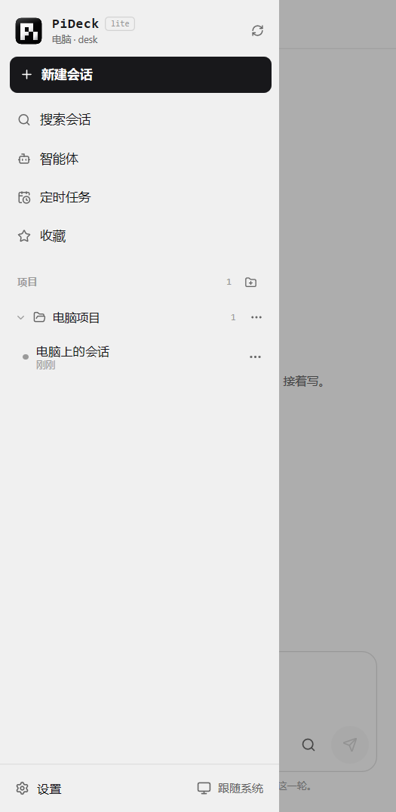

# PiDeck V2

PiDeck V2 是用 [NSGo](https://nsgo.dev/) 重新设计与重写的新一代 PiDeck：一个原生窗口的 pi 工作台。
它不是旧版的精简分支，而是重新实现的版本；应用标识、数据目录（Windows 稳定版为 `%APPDATA%\dev.nsgo.pideckv2`）、
环境变量（`PIDECK_V2_*`）与插件 `runtime`（`pideck-v2`）都按 V2 独立命名，旧版数据不会被读取或改写。
`PIDECK_V2_HOME` 可以覆盖数据目录；同一应用 ID 的重装沿用原目录，Dev 发布版使用独立的 `%APPDATA%\dev.nsgo.pideckv2.dev`。
左侧项目与会话，中间标签页与对话，右侧会话面板与文件抽屉；后端直接驱动本机 `pi` 的
RPC 模式。主界面用 NSGo 原生渲染，不依赖 Electron；内置浏览器按需使用系统 WebView，应用不捆绑浏览器内核。整个应用是一个 Go 二进制。


## 本轮补全能力（2026-11-20）

- **会话**：16 个 ACP 预设与 DSH 接入、安装检测、看门狗、按预设记忆模型/模式；pi 分支重试、会话分组与父子回报；子代理/工作流有完整活动历史、原始结果和回合跳转。
- **记忆与输入**：命令面板中的「智能体记忆」，输入框 `!` 执行 Shell；会话文字草稿自动保存。启用记忆工具后，本地 MCP 经 pi 扩展接入回合。
- **浏览器与翻译**：「浏览器」打开系统 WebView，显式共享给可信本机会话后，Agent 可读取快照并申请点击/输入；写操作逐次批准，隐藏页面或跨站会撤销访问。网页和桌面聊天正文的选中文字可直接翻译，也可从整条回复打开翻译面板。
- **多媒体**：工具结果图片与手机缩略图、全屏查看/另存；文件抽屉里的 Markdown/HTML/PDF/图片/音频/视频与 `.docx`/`.xlsx` 直接预览，CSV 表格与 Office/WPS 仍有系统编辑入口；本地 Whisper 的 OpenAI 兼容 HTTP 服务仅允许回环地址，另支持火山转写与 WAV 导入。
- **视频与微信**：「生成视频…」使用 models.json 中的供应商配置，支持 Ark/Seedance 和 MiniMax 网关任务、恢复跟踪、来源会话与本机 MP4。设置 → 集成 → 微信 iLink 提供扫码、绑定可信会话和登录者私聊收发。付费视频与真实微信登录仍需用户账号验收。
- **文件与手机**：WSL/SSH 历史、文件与草稿共用目标 provider，中央编辑器及手机编辑使用版本校验，冲突不覆盖；会话/文件名拼音搜索，手机搜索在原对话逐条定位。
- **生态与设置**：prompts.chat、skills.sh 完整技能快照、中文在线数据库（含 gzip 内容）与校验缓存，大库按有界提示词包保存并支持设置备份；官方/社区 Electron 插件发现与 V2 声明式插件安装分开；独立余额多账户、模型目录自动刷新、MCP OAuth 与原始配置入口。
- **系统**：通知历史、分区缓存清理、减弱动效、代码换行、视频壁纸，加密设置同步（目录/Gist/Drive）、`pideck-v2://` 会话链接与独立 dev 渠道。原生签名、公证、设备通知权限及云账号连接仍需相应环境。

新增持久化数据：`session-groups.json`（分组/关联）、`balance-accounts.yaml`（独立余额凭据）、`memory/`（记忆）、会话文字草稿文件、`video/jobs.yaml` 与 `video/blobs/`（视频记录与产物）、`wechat/connection.yaml`（微信凭据/游标）。配置类文件采用版本校验和原子写入；坏文件按空数据降级。设置包包含分组、余额账户等配置，**可能包含凭据**，请妥善保管；微信令牌、会话内容、记忆、视频与缓存不进设置包或诊断包。云同步使用密码派生密钥和 AES-GCM 加密，密码至少 12 字符，服务凭据不会下发手机。

功能边界及逐项状态见 [路线图](docs/ROADMAP.md)。本轮继续以 v0.12.0 为功能基线；上游 2026-11-19 发布的 v0.13.0 尚未逐项验收。2026-11-21 对 PiDeck dev v0.13.1 做了桌面 UI 对照，逐页查看系统设置、Pi 配置、弹窗、会话、输入区、右侧面板和终端，并按 V2 的现有边界改进设置导航、配置流程、消息/菜单交互和 Windows 终端；范围、仍有差异的页面与截图入口见[对照记录](docs/PIDECK-UI-COMPARISON-2026-11-21.md)。

验证命令、原生界面截图位置、真实目录数据与未验收项见 [本轮验收记录](docs/VALIDATION-2026-11-20.md)。

## 运行

```sh
go tool nsgo dev                     # 热重载开发
go tool nsgo test                    # 无头 UI 与端到端测试
go tool nsgo test -target windows    # 真实窗口测试并截图
go tool nsgo build -target windows_x64
./dist/"PiDeck V2-2.0.0-windows_x64"/"PiDeck V2.exe"
```

前置：使用 pi 后端时 PATH 里有 `pi`。应用用 `pi --mode rpc` 启动它，会话放在应用自己的目录里。
桌面宿主按 `nsgo.yaml` 的 `id` 只跑一个实例：再次启动会把已有窗口带到前台，然后自己退出（macOS/Linux/Windows 都是这样，Windows 靠命名互斥和管道交棒）。开发时让开发版与打包版各占一个实例：`PIDECK_V2_INSTANCE=dev go tool nsgo dev`；否则开发版会被同 `id` 的已安装包接管，看到的是打包版的旧代码。
也可选择 ACP 预设。DSH 使用外部 `dsh --profile acp`（npm 包 `@deepseek-ai/dsh`），不内嵌 DSH host；预设管理提供检测与安装入口。

命令不用记，`go run ./scripts` 会列出所有常用操作：开发、构建单个或全部平台、启动 Android
模拟器、安装 APK、测试和 doctor，挑个数字就行。也可以直接跑某一项，例如
`go run ./scripts dev`、`go run ./scripts build macos_arm64`。

### 手机端

同一份代码的 Android/iOS 目标会显示连接页，而不是桌面工作台：

```sh
go tool nsgo doctor                        # 检查 adb / NDK / Xcode / 模拟器
go tool nsgo dev -target android           # 已连接的 Android 手机或模拟器
go tool nsgo dev -target ios_simulator     # 需要 Mac + Xcode
go tool nsgo build -target android_arm64   # 手机用的 APK
go tool nsgo build -target android_x64     # x86_64 模拟器用的 APK（需要 NDK）
PIDECK_V2_MOBILE=1 go tool nsgo dev      # 在桌面窗口预览手机页
```

连上电脑后先落在**新建会话页**：选一个项目、写下第一句话，会话就在电脑上开起来。左侧**抽屉**照搬桌面端的侧栏——品牌、新建会话、搜索、智能体、定时任务、收藏，然后是一棵项目树，每个项目下是它的会话；底部是设置与主题切换（跟随系统 / 浅色 / 深色）。手机窄屏上抽屉滑出盖住页面，平板或浏览器窗口够宽（≥ 820 pt）时和桌面一样把抽屉常驻在左边、页面在右侧。




会话页交给电脑上的 pi 跑，手机只负责看和写：文件、在会话内搜索、模型与思考等级、审批、Git、会话操作都在标题栏和底部的输入区里。抽屉里的「评审」列出电脑那个项目的拉取请求与议题，能评论、合并、关闭或交给会话评估。

Windows 上的 `nsgo doctor` 只能构建 Android 包并等待设备/模拟器；iOS 模拟器需要 Mac 和 Xcode。

#### 装 Android 模拟器（Windows，一次性）

```powershell
winget install Google.AndroidCLI Google.PlatformTools
android emulator create medium_phone        # 建 AVD，会下载系统镜像（约 2 GB）
android emulator start medium_phone         # 起模拟器，跑起来后才返回
```

`android_x64` 目标（模拟器）需要 NDK，`android_arm64`（真机）不需要。装 NDK：

```powershell
# 下载 NDK r27c 并解压到 SDK 的 ndk/ 下
curl -L -o $env:TEMP\ndk.zip https://dl.google.com/android/repository/android-ndk-r27c-windows.zip
Expand-Archive $env:TEMP\ndk.zip -DestinationPath "$env:LOCALAPPDATA\Android\Sdk\ndk" -Force
Rename-Item "$env:LOCALAPPDATA\Android\Sdk\ndk\android-ndk-r27c" "$env:LOCALAPPDATA\Android\Sdk\ndk\27.2.12479018"
go tool nsgo doctor                          # 应显示 ✓ Android NDK 与 android_x64 ✓ ✓
```

#### 让模拟器连上桌面端

模拟器把 `10.0.2.2` 指向宿主机，所以不走局域网也能连，端口就是「设置 → 远程」里的端口。

1. 桌面端打开 `设置 → 远程`，开启「允许手机连接」；这一栏里有「Android 模拟器」一行
2. 在仓库里运行：

```sh
go run ./scripts android up      # 起模拟器（已在跑就跳过）
go run ./scripts android app     # 构建 x86_64 包、安装、打开
go run ./scripts android link    # 复制 http://10.0.2.2:<端口>/?token=…
```

3. 在模拟器窗口里点「连接地址」输入框，`Ctrl+V` 粘贴，点「连接」

模拟器和宿主机共享剪贴板，所以复制链接后直接粘贴即可；地址里已经带了令牌，令牌框可以留空。

`go run ./scripts android status` 会打印 SDK 路径、当前设备、AVD 和桌面端链接状态。

### 浏览器（Web 端）

同一份代码编译成 WebAssembly 后在浏览器里跑的是「客户端」，和手机端同一套界面：浏览器里没有进程和磁盘，`pi`、文件与 Git 仍然由桌面端提供。桌面以外的代码带 `//go:build !js`，所以工作台不进 app.wasm——

```sh
go run ./scripts dev web                # 浏览器端热重载预览
go run ./scripts web                    # 编 web 目标、brotli 压缩、再编带页面的桌面程序
go run ./scripts build                  # webassets/site 已存在时自动带标签构建
go run ./scripts web → go run ./scripts build  # 页面进 site 后再按目标名构建
```

`scripts build` 会看 `webassets/site/index.html` 在不在：在就自动加 `-tags=webassets`，不在就提示本次不带页面。直接跑 `go tool nsgo build` 不带标签时只有 API，浏览器打开链接会拿到 404（为了不在 `//go:embed` 上编译失败，标签没有写进 `nsgo.yaml` 的默认值）——设置 → 远程 页会在这种构建里显示一条黄色提示。要带页面又不想用脚本：

```sh
GOFLAGS=-tags=webassets go tool nsgo build -target windows_x64
```

浏览器端约 **40 MB 的 wasm，brotli 后 8 MB**；`scripts web` 把 `.wasm` 压成 `.wasm.br` 再删原件，桌面程序因此只增加 8 MB，页面抓下来也只走 8 MB。CI 给这个体积设了 12 MB 上限，桌面代码漏进客户端会立刻失败。

浏览器只在 HTTPS 或 localhost 上才在 `Accept-Encoding` 里带 `br`，用局域网 IP、手机或任何明文 HTTP 地址访问时只带 `gzip`。所以服务端按 `Accept-Encoding` 协商：能收 brotli 的发 `.br`，只收 gzip 的实时压一份 gzip，两者都不收的发未压缩字节。不要把这里改成“只认 brotli、否则 406”——空响应体喂给 `WebAssembly.instantiateStreaming` 就是页面上那句 `Failed to execute 'compile' on 'WebAssembly': HTTP status code is not ok`。

然后在桌面端 `设置 → 远程` 开启手机服务，浏览器打开 `http://<地址>:<端口>/?token=<令牌>`：页面与 API 同源，链接里的令牌自动填好，连过的那台电脑记在浏览器的 localStorage。页面版本比电脑旧时，会提示刷新一下。

浏览器端比手机端多出的一层（`internal/client` 的 `web_route.go` / `web_address.go`，只在 js 构建里生效）：

- 令牌只在连接时从地址里读一次；连上后地址只留路由，`?token=` 被 `history.replaceState` 抹掉，
  不会进浏览器历史、书签或截图。连不上时不清，用错的链接还能改一个字节重试
- 打开的会话写在地址里（`#/session/<会话 ID>`）：刷新、加书签、把链接发给同一台电脑的另一个人，
  都回到同一条会话；切换会话 `pushState`，关掉会话 `replaceState`，浏览器后退先关面板、再回新建页
- 标签页标题跟着会话走（`会话标题 · PiDeck V2`），多个标签能分清；断开连接后回到 `PiDeck V2`
- 地址与导航走 NSGo 现成的 `Scope.AppURL` / `SetAppURL` / `OnAppURLChange`，不直接碰 `history` 与 `document`；
  后者只在 `store_js.go` 里有 `document.title` 一处，与 `webReload` 同一层

`webassets/site/` 是生成物，不进仓库；`webassets/` 下的嵌入源码属于仓库。不带上标签构建时只有 API，访问 `/` 会落到令牌门禁上（带令牌也拿到 404）；局域网地址列表把虚拟网卡（Hyper-V、WSL、EasyTier、Tailscale）排在真实网卡之后并标注出来，因为手机通常经它们连不上。手机上看到的是同一套界面，但它走原生构建，不经过这一段。

桌面工作台生产代码和整个会话导入包必须以 `//go:build !js && !android && !ios` 开头；共享协议放在 `internal/remotewire`，共享显示工具放在 `internal/viewkit`。`internal/architecture` 会检查标签，CI 的 12 MB wasm 上限仍负责兜底。

## 架构

根目录只保留入口。桌面工作台、手机/Web 客户端和可复用边界分别放在 `internal/`，依赖只能朝较稳定的包走：

| 包 | 职责 | 允许依赖 |
| --- | --- | --- |
| `.` | `main`、平台入口的 `Root`、窗口参数与退出钩子 | `client`、`crashlog`、`workbench` |
| `internal/client` | Android、iOS、Web 和桌面手机预览 | `appinfo`、`apptext`、`remotewire`、`viewkit`、`assets` |
| `internal/workbench` | 本机 pi/ACP 会话、文件、Git、终端和桌面界面 | `client` 之外的共享包，以及 `sessionimport`、`schedule` |
| `internal/remotewire` | 桌面 HTTP 服务与客户端共享的 JSON DTO | 标准库 |
| `internal/sessionimport` | Claude、Codex、Cursor、Kimi 等外部会话解析与 pi JSONL 写出 | `apptext` |
| `internal/schedule` | cron 解析与下次触发计算 | 标准库 |
| `internal/viewkit` | 两套界面共同使用的主题、字体、格式化和 Markdown | `apptext`、nsgo |
| `internal/apptext` | 语言选择、翻译查找和嵌入语言目录 | 标准库 |
| `internal/appinfo` / `internal/crashlog` | 版本常量、崩溃日志和数据目录 | 仅 `crashlog -> appinfo` |
| `assets` / `extensions` / `webassets` | 嵌入资源及 Web 站点适配 | 自身 |

`internal/architecture/structure_test.go` 解析所有平台的源码，而不只解析当前 Windows 构建；新增包若没有显式依赖规则会失败。生产 Go 文件上限 800 行、测试 1000 行，建议超过约 400 行就按职责拆分。目录按业务能力划分，不建无边界的 `utils`、`common`、`models` 或 `global` 杂货包。

详细规则见 [`ARCHITECTURE.md`](ARCHITECTURE.md) 和 [`CONTRIBUTING.md`](CONTRIBUTING.md)。

三条硬规则，来自上一版的坑：

1. **一个事实一个来源**。一轮是否在跑 = 最后一轮 `turn.running()`，不看状态字符串、不看进程。
   会话文件、标题、用量各只有一个来源（pi / 配置 / `get_session_stats`）。
2. **有状态的视图不重建**。工具行、思考行的展开状态存在会话上（按调用 id / 步骤 id），
   不属于组件实例；对话行用稳定的轮次/步骤 id 做键；时钟只在需要显示“用时”的叶子里读。
3. **热路径不做线性重算**。文本增量进 `strings.Builder`，40ms 合并一次 `Set`；工具输出按
   24k 截断；长历史按窗口（默认 24 轮）渲染，可“加载更早”。
4. **列表只读变化的文件**。会话列表按（路径、大小、修改时间）缓存元数据，缓存在 `session-meta-cache.json` 里跨重启复用：
   热启动只 stat、不读任何会话文件，冷启动并行解析变化的文件；pi 自己的会话库按项目读，项目
   `.pi/settings.json` 的 `sessionDir` 与全局默认目录都会扫描——
   没显示的项目只读到首行拿到 `cwd`，全部显示（`scanAll`）才解析整个库。
   重命名走配置、不碰文件；设置页只数文件，不解析。

## 功能

**工作台**
- 侧栏自上而下：新建会话、搜索会话、「更多」（折叠智能体 / 定时任务 / 收藏夹），一行分隔线之后是三栏切换——**活动**列出正在运行和待确认的会话（跨项目，点一条回到那段对话）、**聊天**列出内置对话（数据目录的 `chat/`，顶部一行「新对话」）、**项目**是同宽的项目树；一次只显一栏，宽度不变，选中的一栏是浅色胶囊；新建会话跟着当前栏走，聊天栏里建的是内置对话
- 项目列表（本机 / WSL / SSH）：栏头显示项目数量，加号按下拉框选来源——默认本机目录，也可选 SSH 主机或 WSL 里的目录；命令面板「导出项目列表…」
  把项目（路径/名称/分组/目标/ACP 预设）写成 `exports/projects-*.json`，「导入项目列表…」在另一台机器上加回来（已存在的跳过）
- 项目行右侧常驻一个「+」（在此新建会话），鼠标移上去再出现「⋯」，菜单与右键菜单相同（终端、导入、置顶、分组、排序、移除…）；点项目行同时把它选为当前项目，新建会话就落在它的目录里
- 项目信任：新加的项目在第一次发送前询问一次，输入区上方有提示条；旧项目迁移为已信任，内置对话始终受信任；项目右键可信任/撤销信任，手机发消息也会被拦下
- 内置对话（`Ctrl+Shift+N` 或欢迎页「直接对话」）：不绑定项目，会话落在数据目录的 `chat/`，在侧栏的「聊天」栏里列出
- 新建会话从空白开始，不等历史读取：会话一出现就是空对话与输入框；这时后端还能换，所以不启动任何进程，发出第一条消息才启动 pi，或你刚在后端菜单里选中的 ACP 预设。应用会在后台预热一个 pi 进程（本机项目、磁盘上已有会话、没开会话记忆工具时），下一个新会话直接接管它，首条消息不用再等 pi 启动；闲置 10 分钟自动回收，设置 → 诊断的进程列表里能看到并结束它
- 智能体：命令面板「用智能体新建会话…」选代码审查/讲解/重构/测试/文档等预设，工作方式放在每个提问前；输入区徽章可一键清除，自定义智能体放 `agents/*.json`；「管理智能体…」可增删改（写 `agents/custom.json`），也能给当前会话换智能体；新建时可选 pi 或 ACP 后端
- 项目分组：置顶、命名分组、手动顺序；项目默认按最近活动排列，右键「项目排序」可选最近活动 / 创建时间 / 名称 / 手动，会话排序可选最近活动 / 名称；上移/下移会自动切到手动；右键项目还可置顶、移动到分组、重命名（显示名）
- 会话标签页：新建、关闭（进程继续跑）、`Ctrl+Tab` 轮换、标题栏可重命名；右键标签可关闭其他、
  关闭右侧、全部关闭，或复制会话 ID；`Ctrl+Alt+T` 恢复刚关掉的标签
- 分屏页：设置、智能体、定时任务、收藏夹在标签栏里作为一页打开，和会话标签并列；切会话不丢页，点标签切回，关标签或 `Ctrl+W` 关页
- 窗口按钮：标题栏最右侧是应用自己画的最小化 / 最大化（或还原）/ 关闭，和旁边的按钮同一套悬停与按下状态，关闭键悬停变红；Windows 与 Linux 用它取代系统标题栏按钮（Linux 原本完全没有窗口按钮），macOS 保留系统红绿灯。标题栏空白处仍可拖动窗口与双击最大化，最大化按钮不再提供 Windows 11 的贴靠布局浮层
- 内置浏览器：工具栏支持后退、前进、刷新/停止、地址栏回车或「打开」按钮；裸域名、端口和协议相对地址会自动补全为 HTTPS，加载中、页面标题和失败重试会在地址栏下方给出反馈；可把当前站点一次性共享给会话，让浏览器 Agent 按快照识别控件并在每次写操作前请求确认
- 置顶与收藏：会话右键置顶后固定在顶部；右键「存入收藏夹」保存引用；模型收藏后排在选择器最前
- 收藏夹：回复右键/操作行「收藏这条回复」保存正文快照，会话右键「存入收藏夹」只保存引用；命令面板「收藏夹…」可按回复/会话筛选、搜索、复制、回到原会话或删除，最多 200 条，写 `favorites.json`；ACP 会话同样可用。新增、移除和清空都按操作顺序在后台保存，落盘成功后才更新列表并提示成功；失败保留原收藏并提示，可直接重试；退出时等待已排队的收藏保存完成
- 定时任务：命令面板「定时任务…」或侧栏「更多 → 定时任务」在标签栏里打开一页，按五段 cron（支持列表、范围、步长与月份/星期名）建任务，选项目、pi 或 ACP 后端、预设与智能体，写提示词和超时；到点自动新建会话发送，同一任务串行、错过只补最新一次（7 天内），记录运行状态、时间与错误并可跳回会话，写 `tasks.json`；应用关闭时不运行
- 活动：侧栏「活动」栏按会话信号实时聚合待确认与运行中的会话（最多 100 项），栏头给出两类数量
- 会话侧栏：搜索、状态点（就绪/启动/运行/重试/出错）、最近活动时间；子会话按父子嵌套：pi 写在会话头里的 `parentSession` 把持久化的子代理会话和分叉挂到发起它的会话下，默认折叠，行首箭头展开，展开状态在本次运行内保留；搜索时命中项连同它的上级一起显示，正在查看的会话自动展开上级路径；置顶的会话作为顶层读出，翻页按顶层会话计
- 会话右键：置顶、存入收藏夹、重命名、复制会话、导出（默认分享副本；可选 HTML / Markdown / 复制 Markdown，或切换原始内容）、复制 ID、归档（从侧栏隐藏，文件保留）、删除（移到 `trash/`）；项目右键可「显示已归档 / 隐藏已归档」，或打开「已归档…」对话框逐个打开/取消归档；归档会话仍能在命令面板的「已归档」组里按名字找到
- 会话运行操作：标签栏右侧常驻启动/重启、重新读取按钮与「更多会话操作」，标签右键、侧栏会话菜单和命令面板提供相同入口，pi 与 ACP 通用。停止当前运行只中断回复；关闭 Agent 释放进程，保留记录、草稿和标签，切换标签不会自行启动，发下一条消息或主动启动时恢复。运行中关闭/重启会先确认，重启等待旧进程退出后再恢复会话
- 重新读取会话：空闲时读取 pi 当前消息（未连接则读取会话文件），ACP 读取本地归档；保留输入草稿，不重启进程，读取失败保留屏幕上的记录。分叉上一条提问仍在命令面板中
- 分叉：复制到该轮之前的历史到新会话，原提问放回输入框；原会话文件不动。分叉记录来源：侧栏有分支图标，概览里显示「分叉自 …」并可一键打开原会话；命令面板「查看分叉树…」按层级列出整棵分叉树，有子节点的分支可折叠/展开，点任意节点切换

**对话**
- 流式：思考、正文、工具调用实时进入；正文带闪烁光标，30fps 合并刷新
- 思考行：运行中自动展开并计时（“思考中 · 3s”），结束后折成一行，点开看完整推理
- 工具行：动词 + 目标 + （运行中转圈 / 毫秒 / 失败标记 / `+N −M` 改动量 / 内含调用数），
  运行时自动展开显示实时输出；编辑类工具展示带颜色标记的 diff；输出可选中
- 失败/取消：错误行 + 重试；中断的轮次留“已停止”标记；报错之后又答上了的轮次只留错误原文，不再给重试
- 重试：立刻在侧栏开一份「（重试）」的新会话并显示「重试中」转圈，原会话归档并关掉标签页（侧栏「显示已归档」可找回）；分叉写完才把提问重发出去
- 删除：一轮（提问 + 回答 + 工具过程）走 pi 原生的 `context_edit` 移出模型上下文，之后的回合照旧；原文行仍留在会话文件里，token 与费用不回退
- 每轮操作：回复下面是复制回复、修改提问、删除这一轮、收藏、重新生成、从这里分叉；提问下面是复制提问、修改提问、删除这一轮、从这里分叉；翻译与轨迹在回复右键菜单里
- 回复来源：每条回答上方标出回复者（pi 用应用自己的标，ACP 用该 CLI 的品牌标）与回复时间，尾部是耗时与模型
- 过程用时：ACP 工具调用按本地收到开始与结束事件的时间计时；已结束的工具和思考缺少时长时显示 `0ms`。设置、绘图弹窗和过程组内的滚动内容留出滚动条间隙，开关、选项和工具输出不会紧贴滚动条
- 刻度定位轴：对话右缘按轮次排列刻度，长会话自动均匀取样（最多 24 个）；
  点刻度滚到对应位置，滚离末尾时右下角出现「跳到最新消息」
- 修改摘要：每轮结束按文件归并编辑/写入，显示「修改 N 个文件 +X −M」，点开列出路径与单文件改动量，再点路径在编辑器里打开
- 待办条：输入框上方是 Agent 的待办（todo 工具、计划步骤与扩展 widget 三路合并），标题行给「n 完成 · n 进行中 · n 待处理」与当前一项，点开看全部条目；× 收起后列表再变才回来。三路都是活的：一次发全表的调用直接替换，按 id 建一条/改状态/删一条的调用逐项打到现有列表（`create`/`update`/`delete`，含 `subject`、`activeForm`、`done` 这些字段），工具结果里带出的全文计划（`[status] #id: text`）优先；扩展发布 widget 时以 widget 为准，避免同一项出现两行
- 提问卡片：内置 `ask_question` 扩展（随应用写入数据目录，pi 以 `-e` 加载）让模型一次问一题或多题，卡片顶在输入框位置，输入框让位
  - 五种题型：单选（选项可带说明，恒有「自定义输入」）、多选、是/否、单行输入、多行编辑
  - 批量：题签显示已答/已跳过并可跳转，单选/是-否/输入答完自动前进，多选与编辑按「下一题」；多选前后切换保留勾选，可返回继续修改，兼容 `multi-select` / `multiSelect` 题型写法；扩展要求时末尾有「提交审阅」页，全部答完或跳过后才提交
  - 结果回顾：完成的工具结果按题展示原问题、全部选项和说明，勾选并加重最终答案；文字回答、跳过和未作答分别呈现，读取历史会话时也保留
  - 跳过与关闭：每题可「跳过此题」（`skipped:true`，模型收到「用户跳过」而不是猜答案）；× 关闭时已答内容照样交回，一题未答才算整单取消
  - 快捷提交：单行输入回车即答，编辑框点「提交」；答案信封是一次 `extension_ui_response` 的 JSON
  - 多个请求排队：只显示最新一个，答完自动浮出下一个；侧栏会话行显示「待确认」，按停止会把等待的提问一并取消
- 并行问询（`Ctrl+Shift+A`）：在独立会话里问一个问题，可带上主会话最近 6 轮背景；答完可插入输入框、复制或打开问询会话
- 生成图片：命令面板「生成图片…」选供应商与模型、写画面描述、尺寸与数量（1/2/4 张），走 OpenAI 兼容的 `/images/generations`；填「参考图」则改走 `/images/edits` 按描述修改这张图；可连续「再生成」多张、点缩略图选择，结果可插入输入框随消息发送或保存到当前项目
- 视觉桥：命令面板「描述图片…」选一张图（或填路径）、写问题、填视觉模型，走 OpenAI 兼容的 `/chat/completions` 图片输入；返回的描述可复制或插入输入框，给不支持图片的模型读图用；供应商与模型选择会记住
- 输入框工具行：左端「+」添加图片或切换模式，模型与思考等级居中，右端「…」工具菜单集中提示词增强和续写；图片只保留一个菜单入口，也可直接粘贴或拖入；缩略图点一下放大预览，右键复制或另存
- 草稿保护：增强/续写返回时若草稿已经修改或清空，会保留当前输入，并在输入框旁提供结果预览、复制与主动替换；自动替换后可撤销，继续编辑后可复制原草稿。桌面、手机与 Web 共用此交互；结果和撤销快照仅保留在当前运行期间。
- 修改与翻译：消息「修改提问」在本机 pi 会话中创建分支后编辑，保留原会话；ACP/远程会话准备为新消息。把旧提问放回输入框时会保护已有草稿；「翻译回复」直接将正文带入翻译窗口，已有翻译不会被覆盖。
- 输入框模式：左侧「+」菜单里选计划、目标或生图；开启后底栏出现模式标签，标签上的 × 回到普通模式
  - 计划模式：下一轮先出分步计划，答完可「执行计划」「逐步执行」或「修改计划」；逐步执行的每一步同时出现在待办条里（已做/进行中/待做），每步之间询问是否继续
  - 目标模式：写一句话当目标，没完成时自动接着做（最多 12 轮）；答完最后一行写「目标已完成」或「需要你的决定：…」就停；输入框上方的目标条显示阶段、轮次与目标本身，可暂停/继续/清除，按停止只暂停这一轮
  - 生图模式：描述直接画成图，结果放进附件；标签旁的「生图设置」就地选供应商、模型名与尺寸
- 后端选择：输入框下方状态行的后端菜单在第一条消息前切换 pi 与任意 ACP 预设；发过消息后显示为只读标识（会话文件归该后端所有）
- 输入框底部指标：状态行右端按 PiDeck 的写法排一行会话数字——「3 轮 | 回复 7.0s · 流式 — · 均速 89 tok/s | 缓存命中 82% | 输入 128k tok · 输出 9k tok」，运行中末尾转圈并显示实时流式速度；点这一行勾选显示哪几组（轮次、回复速度、缓存命中、输入与输出、上下文占用、费用），设置 → 外观也有一排同样的开关，选择写进 config 的 `footerMetrics`（空为默认四项，`none` 为全关）；没数据的分组自动不显示
- 消息队列：运行中发送时有两种投递，「加入当前回合」在下一次 LLM 调用前生效，「排队到下一轮」等本轮结束再发（默认前者，ACP 只有后者）；输入框上方队列面板列出待发消息，可单条收回输入框或清空；发送方式菜单里还能「并行发送」，把这句话交给一个独立会话
- ACP 会话：命令面板「新建 ACP 会话…」选择内置或自定义预设（每个预设带它自己那家的标，输入框上方的 ACP 徽章也带，一眼看出这个会话跑的是哪个 Agent），外部 CLI 的流式回答与工具调用进入同一时间线，权限请求走应用对话框；首次运行 npx 预设要下载包，握手最多等 2 分钟，超过 8 秒在输入框上方说明正在启动哪个 CLI，失败时连同该 CLI 的 stderr 一起显示，诊断日志里有握手与建会话各自的耗时；项目默认预设在你打开 ACP 预设对话框或后端菜单时提前握手，下一个 ACP 会话直接用这个进程（闲置 5 分钟回收，诊断页可结束）
- ACP 权限档：预设里开启「旁路权限」后，开会话时自动切到该 CLI 自己的「不再询问」档（Claude 的 bypassPermissions、CodeBuddy 的 fullAccess、Qoder 的 yolo…）；CLI 没有这个档就保持它自己的默认并提示一次，启动参数已经定档的 Qoder 预设不受影响
- ACP 预设管理：设置 → 集成 →「管理预设…」或命令面板「管理 ACP 预设…」打开左右分栏的管理器：左边是全部预设与检测/安装状态，右边用两个页签编辑选中的那一个，
  「启动参数」填 id / 名称 / 命令 / 参数 / 环境变量（`KEY=VALUE`，多个用 `;` 分隔），「权限与选项」开旁路权限并查看、清除这个预设记住的会话选项；
  改动写进数据目录 `acp/presets.json`，内置预设被改过后标为「已修改」，可随时「恢复默认」，自定义预设可删除
- ACP 工具：按 CLI 上报的 `kind` 显示「读取/编辑/运行/搜索…」，`locations` 作为目标路径，工具输出取内容块文本
- ACP 命令：CLI 上报可用命令后，输入区出现命令菜单，点一条插入 `/name` 到输入框
- 项目默认 ACP 预设：新建 ACP 会话会记住上次选的预设；「新建 ACP 会话」直接用它，另有一条「选择预设…」可改，预设对话框里可清除默认
- ACP 面板：输入区显示预设名与当前模式，小圆点表示连接/运行/失败状态；点开是 agent 面板——模式切换（`session/set_mode`）、CLI 声明的配置选项（下拉选项与开关，如模型、思考档、审批与权限档）、启动参数（命令、参数、工作目录、会话 ID）、可用命令（点一条插入输入框）与重连
- ACP 配置选项：按 ACP 规范读 `configOptions` 的字符串值与布尔开关，旧式 `modes` 仍然生效；单条选项读不出来时跳过它而不是让建会话失败；设置布尔开关时带上 `type: "boolean"`（CodeBuddy 等按声明类型校验）；除模型与模型参数外，这个预设下选过的模式、思考档与权限会记住并在下次开会话时重放
- ACP 重连：进程退出会标记会话并记录日志，命令面板「重新连接 ACP」可在不关标签的情况下重新拉起
- ACP 完成时和 pi 一样发系统通知/飞书消息，并在结束时写归档
- ACP 权限记忆：选择「始终允许/始终拒绝」后，同一工具不再重复询问，并随归档保留到下次启动；命令面板可清除记忆
- ACP 与智能体/收藏/定时任务：ACP 会话同样能绑定智能体（提示词前缀）、收藏回复或会话引用，也能作为定时任务的后端按 cron 运行；归档恢复时会带回会话的智能体绑定
- 概览：只报告会话自身的事实，不重复别处的操作——状态与更新时间、标题（铅笔重命名）、工作目录、上下文进度条（接近上限才给「压缩上下文」）、待办进度（可展开整张清单）、本次会话改动的文件（点开看补丁）、子代理与工作流、会话关系（分叉来源与父子会话）、用量（输入/输出、缓存命中、费用、工具调用）与模型/思考档/会话 ID/会话文件；没有会话时显示占位。工作目录与会话文件这类路径各带三个动作：点整行在文件管理器里定位、点复制按钮拿到**完整**路径（行上显示的是缩短版）、点「⋯」在编辑器里打开；悬停整行会提示未缩短的路径
- 导出：命令面板「导出会话…」或会话右键「导出…」默认生成分享副本，只保留提问与回答，隐藏原始标题、思考、系统备注、工具结果和图片，并遮盖可识别的项目路径与凭据；可导出自包含 HTML、Markdown 文件或复制 Markdown 到剪贴板。切换到「原始内容」会保留会话信息；原始 Markdown 按步骤保留中间说明、思考、系统备注与工具输出，分享前请检查；pi 会话的原始 HTML 继续使用 pi 自己的导出。文件写到数据目录的 `exports/`
- 会话正文按过程折叠：一轮跑完后过程收在「N 个工具调用」的居中摘要行后面，答案常驻其下；展开后只有「中途说过话」才另起一组，连续几条消息的思考与工具调用合在同一组里（组头写明“执行过程 · N 个工具调用 · N 次思考”），正在跑的那组自动展开、其余默认收起（一轮没结束就不收起，除非中途说过话），用户的开合选择按组记忆；正在跑的那组组头另外标出现在在干什么（“正在思考”，或“正在读取文件 readme.md”这类带目标的具体动作，跑完了就只剩计数）；打开的组体最高 `min(640px, 60vh)`，调用多时在组内滚动，不会把答案挤出屏幕
- 会话正文按 pi 写入的顺序渲染：一条消息里的正文与工具调用谁先谁后就按谁渲染，不再把工具统一提到正文前面；流式回答原地重绘（只有变化的正文重新排版），不再每次增量重建整段消息
- 输入区：Enter 发送 / Shift+Enter 换行；运行中回车按「发送方式」投递（默认加入当前回合，选了排队则等本轮结束）；空输入时按钮变“停止”
- 上下文压缩卡片在同一位置更新进行中、成功、失败或取消状态；每次压缩保留独立记录，压缩期间继续生成的回答仍归原回合。长摘要默认仅显示前 6 行、最多 600 字的预览，可点击「展开全文」查看完整内容或「收起」恢复预览，每张卡片分别记住本次运行内的展开状态。
- 模型菜单：按供应商分组（组头带该供应商的标）、显示供应商名与上下文大小、每行带模型家族标（经转售的 Claude 仍显示 Claude 的标）、每行可星标收藏（收藏置顶）、可搜索；
- 设置 → 模型 → 工具模型：提交摘要、提示词增强、输入预测和文本翻译各自选供应商和模型，互不共用；
  底部「刷新模型」重新向 pi 读取模型与思考档（改完 models.json 或登录后不用重启会话）
- 增强模板：输入框「… → 增强模板…」或设置 → 模型 →「提示词增强模板」编辑，支持恢复默认、取消和保存失败后继续修改；桌面与手机共用，模板与原始草稿分别作为系统指令和用户消息发送。
- 输入框底部：项目与后端切换菜单、会话的智能体、pi 就绪指示，以及一行的上下文统计（占用、缓存命中、费用）
- 上下文圆环：发送按钮左侧的圆环按 `get_session_stats` 的占用比例填充（80% 以上转黄、95% 以上转红，没有数据时留空环）；点开的面板给出占用与窗口、输入/输出、缓存读写、缓存命中（最近一次与会话平均）、费用、最近一次回复的首字/总耗时/速度，以及会话的轮次/工具/消息数与累计 tokens，底部是「压缩上下文」与「会话面板」
- 粘贴/拖入图片，点缩略图放大预览，右键可复制图片或另存；右侧文件抽屉点文件打开预览或编辑器，右键可插入 `@路径`，也可新建/重命名/移到回收站（数据目录 `trash/files`）；抽屉顶部可按名称筛选文件；输入框里打 `@`
  会在光标处列出当前项目的文件（后台扫描，跳过 .git/node_modules 等），↑/↓ 选择、回车或 Tab 插入相对路径
- 拖入文件与图片在后台按顺序处理，期间可继续编辑，就绪后恢复发送；普通文件和目录只插入路径引用，支持中文及含 `#`、`%` 的文件链接；拖入图片单张上限 6 MB，失败项会提示并继续处理其余文件
- 回答里的 Mermaid 代码块画成图，TeX/Typst 公式排版显示
- 命令面板（`Ctrl+P`）：命令、项目、会话（最近 60 个）、最近打开的文件、主题与设置项；用过的命令进入「最近」组置顶；输关键词后回车直接打开
- 提示词库（`Ctrl+Shift+P`）：分类、搜索、一键放进输入框；当前草稿可存为新提示词；可从 http(s) 链接导入 JSON/YAML 提示词包，按标题去重
- 快捷短语（桌面端 `Ctrl+Shift+M`，macOS 为 `Cmd+Shift+M`）：输入框左侧消息图标打开，可搜索、插入到草稿末尾或直接发送；直接发送保留原草稿、图片和长文本附件，运行中沿用引导/排队方式（ACP 排到下一轮），生图、重试和待审批时禁用直发。设置 → 通用 →「快捷短语与回复规则」可编辑短语、增删匹配规则、恢复默认或清空列表，各最多 30 条
- 回复快捷操作（桌面端）：仅在最新一轮结束后的回复末尾显示；支持成功、失败、每轮结束以及正文正则匹配（忽略大小写，同一条件的多条正则任一命中，多个条件须全部满足）。代码块、行内代码和思考标签不参与匹配；「提交 / 提交并推送」还要求会话曾有成功的文件编辑/写入工具调用。点击发送按钮仍保留草稿与附件，不会自动发送建议
- 会话大纲（`Ctrl+Shift+O`）：每个提问一行，点一下跳到那一轮；长会话里比滚轮快
- 会话内查找（`Ctrl+Shift+F`）：右上角浮层按关键词筛选当前对话（提问、回答、思考与工具输出都算），并高亮回答与思考里的命中处，显示匹配轮数与处数，↑/↓ 或回车跳转，Esc 关闭即恢复
- 全局搜索（`Ctrl+F`）：搜所有 pi 会话与 ACP 归档的标题与正文，可切换「全部 / 标题 / 正文」过滤，顶部显示命中会话数与匹配处数，结果显示匹配片段，点开即进入会话，回车直接打开第一条；打开过的搜索词留在「最近搜索」里，一键重搜或清除。搜索在后台完成，换词时立即移除过期命中，回车也始终使用当前输入。
- 模型与思考循环：`Ctrl+M` 在当前会话「收藏的模型」之间循环，`Ctrl+T` 在当前模型支持的思考档位之间循环；两者只改当前会话，不动新会话的默认值。

**文件编辑器**
- 点文件抽屉里的文件，中央区域换成编辑器：语法高亮、行号、折叠、查找替换、多光标
- `Ctrl+S` 保存，`Ctrl+Alt+S` 保存所有文件（编辑器工具栏也有按钮），`Ctrl+W` 关闭；未保存时标签有圆点，关闭或重新读取前会确认；工具栏可切「自动换行」（记在配置里）；`Ctrl+G` 按行号跳转，状态栏显示光标行列
- `Ctrl+K` 快速打开文件：按文件名匹配（名字前缀 > 名字包含 > 路径包含，同档短路径优先），回车打开，列表复用文件抽屉的后台扫描索引；空查询时先列「最近」打开过的文件（最多 20 个，记在配置里）
- `Ctrl+Alt+F` 在文件中搜索：输入关键词回车，首次目录扫描和内容搜索都在后台执行；按文件分组列出匹配行（忽略大小写，每文件最多 5 处、共 200 处，跳过二进制与 2 MB 以上文件），点一条打开文件并跳到那一行。结果仅属于发起搜索的项目，切换项目后隐藏旧结果，新查询开始时清空旧结果
- 底部状态栏显示路径、语言、是否已保存、总行数与光标行列；工具栏可重新读取、在文件管理器中显示
- 设置 → 外观可调编辑器字号（11–20 pt，行高按比例跟随）、聊天字号（14/16/18/20 pt，默认 16；正文、提问、标题和代码一起缩放，过程字号不再封顶）、聊天行高（1.45/1.6/1.8/2.0 倍，默认 1.6）、输入框字号（跟随聊天或单独选）、以及界面/等宽字体；改完立即重绘。默认系统字体栈包含中日韩回退，保留已保存的自定义字号与字体
- 只编辑本机项目的文本文件；超过 4 MB 或二进制文件会给出原因而不是半打开，并留下「在系统应用中打开」的出口
- 文件树显示 Git 状态：M/A/D/?/U 字母标记，折叠的目录有改动时显示圆点

**文件预览**（点文件直接预览，右键「在编辑器中打开」仍可看源码）
- 预览是工作区的分屏标签页（与设置、浏览器同一种页面），不再弹窗：标签栏出现「文件预览」，工作区让给它，关标签页即关文件
- Markdown 渲染成正文（标题、列表、表格、代码高亮、相对路径的图片），头部「编辑文本」进入编辑器
- HTML 用应用内的 WebView 加载（相对 CSS/JS/图片照常生效，页面脚本会运行，与本机浏览器打开一致；视图不保留 cookie 与站点数据，也不向 Agent 共享）；PDF 交给平台的 WebView 自带阅读器，不支持的平台用「在系统应用中打开」
- 图片（PNG/JPEG/GIF/WebP/SVG 等）按比例缩放查看；音频（MP3/M4A/AAC/WAV/FLAC/OGG/Opus）有播放/暂停、进度拖动与时长，关标签页即停止；视频（MP4/MOV/WebM/MKV/AVI 等）用原生播放器
- `.docx` 显示正文文字，`.xlsx` 把第一个工作表当表格显示（共享字符串、布尔值，数字按文件存储值）；两者都是只读预览，宏、公式与版式不渲染
- CSV/TSV 仍是有界表格预览（1000 行 × 48 列）；压缩包、可执行文件、字体、数据库等显示格式、大小与修改时间，并提供系统应用入口；`.doc`/`.xls`/`.ppt` 等老格式与 WPS 文档沿用系统关联应用
- 预览都限本机项目内的路径，读取有大小上限（文本 2 MB、文档 16 MB），超限与损坏会说明原因而不是空白

**改动与历史**（同样是分屏标签页，不弹窗）
- Git 抽屉里点改动的文件、点提交行：打开的「改动」标签页显示补丁（左侧文件列表用于提交）；未跟踪文件按整文件新增显示
- 对话里「修改 N 个文件」展开后点某个文件：读的是它相对 HEAD 的补丁（新文件按新增显示）；不是 Git 仓库的项目退回打开文件本身
- 改动页头部的「历史」「追溯」各开一页：「文件历史」列该路径的提交，「追溯」按行段归给提交；点一行提交会把它的补丁显示在「改动」页
- 评审里的「查看补丁」同样是分屏页，不再弹窗
- 文件树右键：新建文件（建完直接在编辑器打开）、新建文件夹、重命名；重命名会同步编辑器里已打开的文件
- 文件右键还有「加入 .gitignore」：按相对路径追加一行（已有则不重复，缺 `.gitignore` 会新建），随后刷新文件树与 Git 状态
- 右键文件：预览（可预览的文件才有）、在内置编辑器或外部编辑器打开、插入 `@` 路径、在文件管理器中显示、复制相对路径
- 外部编辑器：自动探测 VS Code / Cursor / Windsurf / Zed / Sublime / JetBrains 系列；也可在 设置 → 环境 填自定义命令

**终端**
- 底部终端面板（`Ctrl+Shift+T` 或标题栏按钮），可拖动上沿改高度，关闭面板后 shell 继续运行
- 多标签：新建、切换、关闭、重启、清屏；标签跟随程序标题（右键可重命名），右键可关闭其他/全部终端
- Windows 本机可从终端栏选择已安装的 PowerShell、Windows PowerShell、cmd 或 Git Bash；WSL 与 SSH 仍使用目标自己的 shell
- 真 PTY + Ghostty 终端模拟器（NSGo `base/terminal`）：颜色、宽字符、滚动回看、程序自绘 UI
- 终端配色跟随应用主题：底色、文字、光标与 ANSI 常用色取自当前调色板，浅色/深色各自成立；
  字号在 设置 → 外观 里用滑块调（8–20 pt），立即重绘并记住
- 在项目目录打开；本机、WSL、SSH 三种目标各自起 shell
- 搜索（高亮、上一个/下一个）、复制/粘贴/全选、右键菜单

**Git**
- 右侧 `Git` 抽屉：分支、上游、领先/落后数，获取 / 拉取 / 推送（无上游时一键发布到 `origin`）；
  分支菜单可切换本地/远程分支、新建分支，非当前分支可删除（`git branch -d`，先确认），远程分支可「push --delete」（先确认）；
  「更多」菜单里可贮藏/恢复改动，或打开贮藏列表逐条弹出、应用、删除；也可查看标签、在当前提交打标签或删除标签；「远端…」列出名称与地址，可复制、添加或删除远端
- 改动分「已暂存 / 更改」，逐文件暂存、取消暂存、丢弃；全部暂存 / 取消暂存；未跟踪与冲突状态。文件路径按原名匹配，`[id]` 等特殊字符不会连带选中其他文件；桌面、手机接口及 WSL/SSH 目标共用此规则
- 改动列表默认按目录树折叠（点文件夹收起/展开），也可以切成平铺列表（右上角的切换按钮，选择写进 `config.json`）；一屏只放前 8 个改动，「还有 N 个文件未显示」展开全部，「收起」回到第一页；改动文件右键可看差异、文件历史、追溯或丢弃
- 冲突：改动区顶部出现「N 个文件有冲突」，点开可逐个「用我的版本 / 用对方版本 / 标记已解决」；冲突行只有「解决冲突」入口，不提供会失败的丢弃；对话框里的「中止合并…」回到操作前（`merge/rebase/cherry-pick --abort`）
- 提交框在最上方：多行说明、提交、提交并推送（有上游时）、全部提交、修订上次提交；空说明时列出最近 3 条提交说明，点一下填入；无暂存时禁用；✨ 按暂存改动生成提交说明（需在 设置 → 模型 → 工具模型 配置）
- 历史：默认列出最近 5 次提交，「显示更早的提交」每次再加 10 条，读到底后「加载更多提交」按页从仓库读到 500 条；可按标题/作者/哈希搜索；点开看完整补丁（统一 diff、可选中复制）；右键提交可复制哈希/说明，或按远端地址在浏览器打开（GitHub / GitLab / Bitbucket 路径）
- 更多菜单：「未推送的提交…」列出上游没有的提交，点开看补丁；「撤销上次提交…」把上次提交放回暂存区（`git reset --soft HEAD~1`），文件内容不变
- 补丁对话框里的「历史」列出改过这个文件的提交（最多 50 条），点一条看那次提交的补丁
- 提交补丁上方列出这次改动的文件，点一下关掉补丁并在编辑器里打开该文件
- 补丁对话框的「追溯」按行归属列出改过这些行的提交（前 2000 行），点一条看那次补丁
- 分支菜单：切换本地分支、列出远程分支（点击创建并切换到跟踪分支，垃圾桶图标删除远端分支）、新建并切换
- 其他：初始化仓库、贮藏全部改动 / 恢复最近贮藏、丢弃全部改动
- 同一套操作跑在本机、WSL、SSH 目标上；面板每 4 秒自动刷新状态，保留已加载的远程分支、标签、远端与历史分页信息；按「刷新」重新读取完整仓库

**评审**
- 工作区里的「评审」页（侧栏「更多」里也能直接打开，标签栏里和会话并列）：项目里的拉取请求与议题各一栏，`打开 / 已关闭 / 全部` 三种筛选、标题编号标签搜索、加载更多；每行显示检查结果、评审结论与增删行数
- 读哪个仓库显示在列表上方：项目本身就是一个 git 仓库时读它；项目文件夹下直接放着的多个仓库（各自有 `.git`）会列成菜单，点一下切到那个仓库，列表随即重读
- 详情：描述与讨论（Markdown 渲染）、检查列表、改动文件与行数、评审结论、「查看补丁」用统一 diff 看整个补丁（可选中复制）；可发评论、提交评审（批准 / 请求修改 / 只评论，评论框里的文字随评审一起提交）、合并（压缩 / 合并提交 / 变基）、关闭或重新打开，也有一键跳到浏览器
- 面板在前台时每 30 秒重读一次列表与打开的那一条，别处合并或评论过的变化会自己出现；读取失败时保留正在看的内容，不闪白
- 「AI 评估」把当前条目交给新的 pi 会话：会话自动带上 `gh pr view` / `gh pr diff`（议题是 `gh issue view`）与四段式评审要求，结论落在会话里，接着说要改什么就能改代码
- 数据来自本机 GitHub CLI：`gh` 自己持有凭据，应用不存 token；没装时面板给安装提示，装了但没登录时给登录提示（在终端跑 `gh auth login` 后点「重新读取」），不报错。命令跑在本机 / WSL / SSH 目标上，与 Git 面板一致
- 手机端抽屉里的「评审」是同一份能力：列表、详情、评论、提交评审、合并、关闭 / 重开、看补丁与「AI 评估」（让电脑开会话，手机直接跳到那条会话读结论）

**远程访问**
- 设置 → 远程：开启手机服务，设置端口、访问令牌；每个地址可「复制链接」或显示二维码
- 访问令牌过期（默认关闭）：打开后电脑每 24 小时换一个令牌，看过的链接会自动作废。
  仍连着的手机和网页靠响应头 `X-PiDeck-Token` 自动接上新令牌，不用重新扫码；断开超过一天的
  设备需要重新复制连接链接。关掉后令牌永久有效，等同旧行为
- 连接方式：局域网（本机所有非回环 IPv4）、Tailscale（读 `tailscale status` 的 100.x 地址）、
  EasyTier（读 `easytier-cli` 的虚拟 IP，读不到时可手动填写），以及不需要虚拟网卡的中继
- 外网访问：电脑主动连到中继，手机扫「配对链接」即可，两端都不用装 VPN、Tailscale 或 EasyTier。
  中继只转发字节；桌面在隧道里再跑一层 TLS，手机按配对链接里的指纹固定证书，中继看不到令牌与会话内容。
  适合手机长期开着 VPN 或代理、不方便再加一层虚拟网卡的情况
- 中继部署：推荐 **Cloudflare Worker**（`infra/relay-worker`），不需要服务器、不需要固定 IP，
  也不影响用户自己的网络。本仓库当前的发布默认是 `wss://relay.caoayu.top/v1/tunnel`
  （见 `internal/workbench/relay_default.txt`）；国内网络可能连不上 `*.workers.dev`，所以绑定自己的域名更稳：

  ```sh
  cd infra/relay-worker
  npm install
  npx wrangler login
  npx wrangler deploy
  ```

  在 `wrangler.toml` 里给 `relay.example.com/v1/tunnel` 配路由（或直接用 Worker 的 `*.workers.dev`
  地址），然后把 `internal/workbench/relay_default.txt` 里那一行改成这个地址——它会被编进
  桌面端，手机从二维码里拿地址，用户不需要填写；也可以用
  `-ldflags "-X example.com/pideck-v2/internal/workbench.defaultRelayURL=wss://…"` 覆盖。
  部署也可以走 Actions：`.github/workflows/deploy-relay.yml`，配好
  `CLOUDFLARE_API_TOKEN` / `CLOUDFLARE_ACCOUNT_ID` 两个 secret 后手动触发。

  Worker 用 Durable Object 按环境号配对一台电脑和一台手机，空闲时休眠，不存令牌、不落盘会话；
  两端都在隧道里再跑一层 TLS，Worker 只转发密文。费用：Workers 免费额度是每天 10 万次
  Durable Object 请求、1.3 万 GB-s，WebSocket 入站消息按 20:1 折算、出站消息和协议 ping 免费，
  没有流量费；小规模用户通常落在免费额度内，超出后 Workers Paid 从 $5/月起。
  也可以自建 Go 中继：`go build -o pideck-relay ./cmd/pideck-relay`，放到有公网入口的机器上，
  前面用 Caddy 终止 TLS 并转发到 `127.0.0.1:8080`（Caddy 自动处理 WebSocket）。
- 自定义公网地址：已经用 Cloudflare Tunnel、frp、nginx 等把远程端口映射到自己的域名时，
  把 `https://你的域名` 填进「自定义公网地址」，它会生成带令牌的链接和二维码；路径会被忽略，
  转发要指向服务根路径。完整步骤（含 Tunnel、Worker、反向代理和常见问题）见
  [docs/remote-self-host.md](docs/remote-self-host.md)
- 用户也可以用自己的 Cloudflare Worker/域名：把地址填进「中继地址」，点「测试连接」再打开开关；
  直接粘贴 Worker 的 `https://…` 地址会自动换成 `wss://` 并补上 `/v1/tunnel`，也可以一键「恢复默认」。
  部署步骤见 [infra/relay-worker/README.md](infra/relay-worker/README.md)。中继只转发密文，
  换成别人的中继也不会泄露令牌
- 中继的连接按 30 秒心跳保活；浏览器端打不开原始套接字，所以中继只在 Android/iOS App 里可用，
  网页端继续走局域网或 Tailscale
- 手机端连接后浏览电脑上的项目、会话和会话历史，列表每 2.5 秒刷新（会话运行中 1.2 秒）；界面支持简体中文、英文、繁體中文、韩文、日文、俄语和法语，首次跟随手机系统语言，可在设置中切换并保存，也可用 `PIDECK_V2_LANG` 指定初始语言
- 手机端能做的会话操作：
  - 新建：标题栏「+」，只有一个项目时直接建，多个项目时先选项目；建完直接进对话
  - 搜索：标题栏放大镜。先按标题过滤，同时去电脑上搜**所有会话的消息内容**
    （≥2 个字，300ms 防抖，命中显示片段；点一下进那个会话并直接落到匹配处）；
    会话内还能再按内容过滤已加载的消息
  - 失败重试：最后一轮失败时，输入框上方出现「重试上一条」
  - 提问（批量提问）：电脑上的 pi 一次问好几题时，手机上同样出一张卡片，每题按类型作答
    （选项、多选、是/否、填写），可以跳过某一题，全部答完或跳过后「提交」，答案按扩展读的信封回传；
    「取消」或关闭卡片是让整个请求作废
  - 扫码连接：连接页「扫码连接」优先调系统相机实时识别桌面上的二维码，自动填地址和令牌并连接；
    如果二维码只含地址，会保留地址并清空旧令牌，填写访问令牌后即可连接；
    粘贴的完整链接只会在令牌栏为空时填入链接令牌，手动输入的新令牌优先；
    取消不会清空连接表单；设备不支持实时识别但相机可用时改用拍照识码，没有相机或相机权限不可用时可从相册选二维码（图片上限 6 MB、2000 万像素）
  - 记住连接：连过的服务器存在手机里，连接页「最近连接」一键重连（最多 5 个）
  - 连接切换：手动断开会清除旧错误，鉴权失效等被动断开会保留原因；断开后可立即重连，旧连接迟到的结果不会覆盖当前状态、恢复已断开的连接或误断开新连接
  - 会话切换：正文、历史分页与模型设置的读取结果按当前连接、本次打开会话隔离；离开或断开会立即释放加载状态，切走再回来也不会混入旧消息或旧错误
  - 文件切换：列表结果绑定当前电脑和项目；切换项目或断开后，迟到响应不会覆盖新列表或卡住加载；断开时保留编辑文本供复制，并撤销旧电脑的保存版本
  - 项目：标题栏「⋯ → 添加项目…」按电脑上的文件夹路径添加，长按项目标题可移除
    （只从侧栏移除，文件不动）；没有会话的项目也会列出来，点一下就能在里面新建
  - 行内「…」：重命名、置顶 / 取消置顶、删除（删除会二次确认，文件进电脑的 `trash/`）
  - 发消息：底部多行输入框（自动换行长到 5 行左右，回车换行，发送键发送）；
    输入卡片里是文字和附件，下面一行左边是模型、思考等级、用量，右边是图片、「+」和发送；
    点模型或等级打开「会话设置」
    （模型、思考等级、后端；新会话页的这两个按钮会先建好会话，再让你选）；
    「+」是添加与工具：计划 / 目标模式、把这句话画成图、插入文件（@路径）、
    用电脑的模型增强这句话或接着续写；计划或目标模式在输入框上方出现一个可点掉的模式标签；
    运行中多一个停止键（不挡输入，pi 会排队），回复按 1.2 秒轮询流式出现；
    发出后输入框立即清空，不再弹「已发送」：消息本身出现在会话末尾就是回执；
    发送失败会把文字放回并说明原因
  - 会话列表：每个项目默认只列最近 3 天的会话（置顶、运行中、等回答的会话即使更早也留着）；
    更早的收在「展开更早的 N 个会话」下面，点一下就展开，再点「收起更早的会话」收回
  - 审批：电脑上的 pi/ACP 在等确认或选项时，输入框上方出现提示卡，
    可直接允许/拒绝或选一项，答案回传电脑让那一轮继续
  - Git：项目标题右侧的分支按钮打开仓库面板，显示分支、上游、领先/落后与改动文件；
    点分支行切换本地分支，获取/拉取/推送三个按钮同步；文件可暂存/取消暂存、
    点右侧箭头看补丁，写一句说明即可提交（只提交已暂存的内容）；改动下方列出最近提交
  - 文件：会话右上角的文件夹按钮打开项目文件列表，可按路径筛选；点开只读查看文本
    （512 KB 以内，二进制与超大文件会说明原因），接口只接受本项目内的路径；查看页可再按关键词筛行
  - 工具调用跟桌面端一样：一轮还在跑时逐条显示（工具图标、动词、目标、改动行数、用时、失败标记，
    点开看输出），跑完把这一轮的过程折成一行「N 个工具调用」，点开原地展开；
    思考在运行中是一条会往前滚的单行（最新的话留在右边），跑完折成「思考」一行，点开看全文
  - 图片：输入框右侧的图片按钮从相册/文件里选（最多 4 张、单张 6 MB），
    选完在输入框上方出缩略图，点缩略图移除；可以只发图不写字；
    点会话里的缩略图是整屏查看器（图片铺满整屏，点图或右上角关闭，底部「另存图片…」）
  - 长按任意消息复制；往上翻后右下角出现「最新」，点一下回到底部
  - 会话列表下拉刷新
  - 模型与思考：输入框上方一行显示当前模型和思考等级，点开是原生底部弹层，
    可切模型（按供应商分组，每行带模型家族标）和 low/high/max；同一行还显示上下文用量与费用（有数据时）
- 令牌鉴权；链接含令牌；pi 自己的会话只能在电脑上删除
- 令牌过期开启后，一道带着旧令牌的请求仍能成功，并在响应头 `X-PiDeck-Token` 里拿到当前令牌；
  超过一个周期未再请求过的旧令牌一律 401，客户端重连时需要电脑上重新复制的链接

**手机端的接口**

| 方法 | 路径 | 作用 |
| --- | --- | --- |
| GET | `/api/ping` | 主机名与版本，连接时探活 |
| GET | `/api/state` | 项目、会话、置顶、运行状态与等待回答的问题 |
| GET | `/api/session/{id}` | 一个会话的消息；运行中带 live 文本，等待回答时带 `ask` |
| GET | `/api/session/{id}/options` | 模型列表、当前模型、思考等级、后端与可用草稿工具；pi 没起会顺手拉起 |
| GET | `/api/search?q=&project=` | 跨会话搜消息正文，返回会话、标题与片段（按文件缓存） |
| GET | `/api/git?project=` | 项目的分支、上游、领先/落后与改动文件（只读） |
| GET | `/api/git/diff?project=&path=` | 一个改动文件的补丁；只接受仓库已报告的路径 |
| POST | `/api/git/stage` | `{project,path,stage}` 暂存或取消暂存一个文件 |
| POST | `/api/git/commit` | `{project,message}` 提交已暂存的内容 |
| POST | `/api/git/checkout` | `{project,branch}` 切换本地分支 |
| POST | `/api/git/sync` | `{project,action}` 获取 / 拉取 / 推送 |
| GET | `/api/review?project=&kind=&state=&q=&limit=` | 项目的拉取请求（`kind=pr`）或议题（`kind=issue`）；`missing` 表示这台机器没有 gh |
| GET | `/api/review/detail?project=&kind=&number=` | 一条的描述、讨论、检查与改动文件 |
| POST | `/api/review/action` | `{project,kind,number,action,body,method}` 评论 / 合并 / 关闭 / 重开 |
| GET | `/api/review/diff?project=&number=` | 拉取请求的整份补丁（统一 diff） |
| POST | `/api/review/evaluate` | `{project,kind,number}` 让电脑开一个会话评估它，返回 `{session}` |
| POST | `/api/projects` | `{path,remove}` 在电脑上添加/移除项目文件夹 |
| POST | `/api/sessions` | `{project}` 新建会话，返回 `{id,title}` |
| POST | `/api/sessions/{id}/prompt` | `{text,images:[{mime,data}]}` 发一条消息；运行中自动改成 steer |
| POST | `/api/sessions/{id}/stop` | 停止当前一轮 |
| POST | `/api/sessions/{id}/rename` | `{title}` 改名 |
| POST | `/api/sessions/{id}/pin` | `{pinned}` 置顶或取消 |
| POST | `/api/sessions/{id}/model` | `{provider,id}` 切模型 |
| POST | `/api/sessions/{id}/thinking` | `{level}` 切思考等级 |
| POST | `/api/sessions/{id}/mode` | `{mode}` 下一轮要什么：`plan` / `goal` / `imagegen`，`normal` 回到普通提问 |
| POST | `/api/sessions/{id}/backend` | `{backend,preset}` 换 pi / ACP 后端；第一条消息之后拒绝 |
| POST | `/api/sessions/{id}/tools` | `{tool,text}` 用电脑的工具模型改写（`prompt`）或续写（`predict`）草稿，返回 `{text}` |
| POST | `/api/sessions/{id}/image` | `{prompt}` 用电脑的生图供应商画一张，返回 `{images:[{mime,data}]}` |
| POST | `/api/sessions/{id}/answer` | `{confirmed}` / `{value}` / `{cancelled}` 回答电脑上等待的确认、选项或输入 |
| POST | `/api/sessions/{id}/delete` | 删除会话（pi 自己的会话会拒绝） |
| POST | `/api/voice` | `{format:"wav",data}`（base64 的 16 kHz 单声道 WAV）转写成 `{text}`；识别在电脑上调用火山引擎，未配置凭据返回 503 |

**会话与数据**
- 应用自己的会话目录（pi 原生格式），重启恢复标签与历史
- 会话列表缓存：`session-meta-cache.json` 记住每个会话文件的大小、修改时间、标题、ID 与目录；
  重启后只 `stat` 不解析，变了的文件才重读（冷启动并行解析）；文件只是变长时从上次停下的
  位置继续读（比对停下点前 256 字节的校验和，改写过的整份重读）；删掉的会话条目跟着清掉；
  缓存格式变了、文件坏了都当冷启动，只慢一次
- **项目下的 pi 本地会话**：只读当前项目的目录，与项目会话合并后按时间分组；
  默认显示 10 条，「更多」每次展开 40 条，展开后可「收起」；点会话用
  `--session <file>` 继续；设置里可切换成“扫描所有项目”
- 加载占位：项目历史与项目会话数量在读取时显示 pulse 骨架；打开历史会话时先把会话文件读到正文里
  （解析按大小+修改时间缓存，会话变长只读新尾部），pi 起来后消息数一致就不再取 `get_messages`，
  对不上（压缩过或正在跑）才回退
- 导入会话（欢迎页「导入会话」、命令面板「导入会话…」，或项目右键「导入会话…」）：一个对话框扫遍
  Claude Code / Qoder / Codex CLI / Cursor / Kimi Code / Kimi Work / MiniMax / ZCode / OpenCode /
  WorkBuddy / CodeBuddy 的会话库，**每个来源一个 tab**（外加「全部」），各自勾选、各自导入，不混在一起；
  tab 里的搜索、全选、批量导入与「新 / 已导入 / 有更新」都只作用于当前 tab。从项目右键进来时对话框顶上
  写明「导入到「项目」」，导入的会话全部落到那个项目（点「改为按原目录」回到按会话自己目录归位）。
  转换保留文字、思考、工具调用与结果、图片（超过约 256KB 的图转占位）；从欢迎页 / 命令面板进来时按
  原目录归位（原目录已不在就用当前项目）；只写本应用自己的会话目录，原文件不动。产物头部带 `*_import` 标记
  （源路径、大小、修改时间、转换器版本），所以再导一次是幂等的，源变了才重导并覆盖同一份，
  会话 ID 不变。pi 的 `.jsonl` 仍按原样复制，但头部 ID 必须是安全的文件名部分；删除进 `trash/`
- 导入源的会话库位置可用环境变量覆盖（非标准安装或测试用）：
  `PIDECK_V2_IMPORT_CLAUDE_DIR`、`_QODER_DIR`、`_CODEX_DIR`、`_CURSOR_DIR`、`_KIMI_DIR`、
  `_MINIMAX_DIR`、`_ZCODE_DIR`、`_OPENCODE_DIR`、`_WORKBUDDY_DIR`、`_CODEBUDDY_DIR`
- 配置 `config.json`：工作区（含目标）、标签、收藏、默认模型与思考等级、主题、标题、键位、停用的插件、插件设置、智能体绑定、代理、生图供应商/模型/尺寸、编辑器与终端字号、提示音（开关、每种时刻的音、音量、导入的文件名）、火山语音凭据（App ID 与 Access Token）、匿名统计开关与安装 ID；旧文件读取时自动迁移并回写，越界的枚举/尺寸/端口会重置
- 整理数据：收藏写 `favorites.json`（回复是正文快照、会话是引用，最多 200 条），定时任务与运行历史写 `tasks.json`（历史最多 200 条），自定义智能体写 `agents/custom.json`，导入的提示音放 `sounds/`（同一时间只保留一个，进设置备份包）；插件卸载保留文件于 `trash/plugins/`，可在 设置 → 扩展 恢复，设置包也包含这份回收区；都是可读文件，坏数据不阻断启动
- 快捷短语与回复规则保存在 `reply-shortcuts.yaml`（`version: 1`，最多 256 KB，`quickMessages` 为短语数组，`replyActions` 为规则数组），原子保存，纳入设置备份/同步，不进入诊断包。规则包含 `text`、`triggers`（`kind` 为 `always` / `onStop` / `onFailure` / `textMatch`，后者使用 `patterns` 数组），可用 `requires: fileEdits` 限定成功文件修改。文件缺失时用内置清单，空数组表示主动关闭；坏文件停用快捷操作，坏规则只跳过该条，均保留原文件。打开短语或管理窗口会重读文件；本配置只用于桌面端。
- 增强模板保存在数据目录 `prompt-enhance.md`（UTF-8、非空、最多 24 KB），原子保存并纳入设置备份/同步；不放进诊断包。缺失时使用内置模板，损坏时提示并退回内置模板，不阻断启动；未保存的编辑、AI 结果预览与撤销快照不进入设置包。

**目标：本机 / WSL / SSH**
- 探测：`pi --version`、`wsl -l -q`、`~/.ssh/config` 的 Host，逐个试 `command -v pi`
- WSL：`wsl.exe -d <distro> --cd <dir> -- sh -lc 'exec pi …'`，会话存该发行版的
  `~/.pideck-v2/sessions`
- SSH：`ssh -o BatchMode=yes <host> "cd <dir> && exec pi …"`，同样远端存会话
- 设置页显示每台机器的 pi 路径/版本与错误，可重新探测

**设置**（左栏分类，右侧一行一条，控制项在行尾）
- 通用：新会话默认模型/思考等级、项目下是否列 pi 本地会话、是否扫描所有项目、界面语言
  （跟随系统 / 简体中文 / 繁體中文 / English）
- 工具安全门（通用 → 安全）：关闭/标准/严格三档。快照写到数据目录的 `security-policy.json`，
  由随包 pi 扩展在每次工具调用前执行；标准先确认危险命令并保护敏感文件，严格还会把文件访问
  限制在工作目录内、写操作逐一确认。只对本机 pi 会话生效
- 匿名使用统计（通用 → 隐私）：启动时每天最多发一次心跳到 PostHog，带版本、平台、功能开关与
  数量统计，不含项目路径、会话内容、文件名或凭据；和 PiDeck 进同一个项目，事件带
  `app=pideck-v2`，按这个属性区分是哪个应用。默认开启，关掉后立即停止发送。
- 对话内容宽度：设置 → 界面里的滑块在 50%–100% 之间调整正文与输入框占聊天区宽度的比例，
  拖动即生效（拖完才写一次 `config.json`，80% 为默认、不写入；保留已保存的宽度）；拉到 100%
  时正文与输入框铺满聊天区，不再有 860pt 上限
- Tab 栏宽度：设置 → 界面里的滑块在 8%–30% 之间调整单个会话标签页的最大宽度（占窗口宽度的比例，默认 22%）；设置写入 `config.json` 的 `tabWidthPct`，启动时恢复已保存的值
- 记住位置与尺寸：窗口的大小与位置（含最大化）在创建时就按上次的来，不会先开默认大小再跳；
  侧栏宽度、右侧面板宽度、右侧面板的 tab（概览/文件/Git）、设置页上次的分区、导入对话框上次的来源
  tab、Git 改动列表的树/平铺都写进 `config.json`，重启后回到原处（拖动/缩放停下才写，不会每帧落盘）
- 设置搜索：侧栏顶部输入关键词（中英文均可），结果直接跳到对应分区；命令面板里每个设置项
  也是一条命令（「设置 · 名称」），搜索后回车直达对应分区
- 模型与认证：供应商列表（品牌标、模型数、API、BaseURL、凭据来源）、`pi auth check` 的就绪状态与原因、
  一键在内置终端里跑 `pi auth login`、常用模型（收藏）管理；除 `models.json` 里的供应商外，
  pi 内置目录（`models-store.json`）里的供应商也列出来并标明「内置」
- pi 凭据：列出 `auth.json` 里的供应商、类型、来源与掩码密钥——`api_key` 写明是写入文件、
  `$环境变量` 还是 `!命令`，OAuth 写明剩余（或已过期）时长与是否可续期；可检测、替换 `api_key`、
  添加或删除。只写该供应商的 `type`/`key`，OAuth 等其他字段保持原样，文件权限 0600。
  `null` 等非对象条目不列入可编辑列表；文件根内容为 `null` 或目标条目不是对象时拒绝保存并保留原文件，可在原始 JSON 中修正
- 供应商认证：供应商配置顶部显示认证状态、凭据来源（auth.json / models.json / 环境变量）与
  原因，可「登录…」（终端里跑 pi 自己的登录流程）、「检测」（让 pi 重新解析并续期）、
  「登出」（`pi auth logout`）与复制登录命令
- 供应商配置：点供应商右侧的设置按钮改 `api` / `baseUrl` / `apiKey`（只写这三个字段，
  其余保持原样），可一键测试连接（先探 `/models`，再退到一次最小 chat 请求），
  也可查询余额（OpenRouter / Moonshot / DeepSeek / SiliconFlow 按 BaseURL 或供应商 ID 识别；
  其他供应商可在供应商配置里填「余额接口 / 余额字段 / 余额货币」，字段是 JSON 路径，支持数组下标）
- 添加供应商：在 设置 → 模型与认证 中填写供应商 ID、API 类型、Base URL、可选 API Key 和首个模型，保存后立即出现在该页的工具模型选择中；pi 会话读取新供应商时按原有流程重启 Agent
- 模型条目：供应商配置里可直接增删改 `models`（id / 名称 / 上下文 / 最大输出 / 推理 / 图片输入 /
  四项价格），并可视化编辑 7 个 `compat` 开关（自动/打开/关闭，pi 的内置目录给出的建议会显示出来）；
  只写这些字段，条目里的其余字段与其余 `compat` 键保持原样
- TokenDance 内置供应商：设置 → 模型与认证 的「TokenDance 账户」里点「登录…」——浏览器确认一次，
  授权码经本机回环端口回到应用并换成 API Key（PKCE S256，verifier 只在内存），Key 直接写进
  models.json 的 `tokendance` 供应商；也可以「填入密钥…」手动粘一把已有的 Key（先查余额校验）。
  同一处可看余额、拉取平台目录（目录里所有模型都写进去，`contextWindow` 只写正数，pi 才不会拒绝
  整个供应商；目录里没有的条目保留，按新增/更新/保留报数）、按整数元充值（生成支付宝聚合码，
  查询地址只认平台域名，二维码就地出示，每 3 秒查一次，到账后自动刷新余额）
- 请作者喝咖啡（爱猹收打赏）：设置 → 关于 → 链接 里点开，走 PiDeck 的支付代理（平台 Key 只在代理里，
  客户端拿不到），出示当次购买二维码、可唤起支付宝；纯打赏，不绑定会话和用量，付款后每 5 秒重查一次。
  本机的安装级用户 ID 存在 `config.json` 的 `watchaUserId`（首次使用时生成）
- pi 设置：设置 → 模型与认证 里可直接改 pi 的 `settings.json` 常用项——隐藏思考块、安静启动、
  折叠更新日志、默认思考档、自动重试与次数、自动压缩与两个 token 阈值；其余字段原样保留
- 原始配置：直接在内置编辑器里打开 `models.json` / `settings.json` / `auth.json`
- 外观：配色（跟随系统/森系绿/石墨灰/海盐蓝/羊皮纸/终端，每项带一张配色缩略图；纸白/炭黑只在当前选中时出现）、背景图片与透明度（面板一起变透明）、聊天/输入框字号与行高、界面字体与等宽字体（等宽字体覆盖代码、工具输出、编辑器与终端）、打开主题目录、
  把当前配色导出成主题文件（含 tokens、字体与圆角）、从文件导入主题（JSON/YAML，拷进主题目录，同名不覆盖）、删除用户主题（移到回收站）；`Ctrl+Shift+L` 或命令面板「切换深浅色」
  在跟随系统/纸白/炭黑之间轮换
- 环境：pi 路径与版本、pi 会话目录、WSL 发行版与 SSH Host 的检测结果、添加远程工作区；外部编辑器命令与网络代理（应用请求 / Agent 进程、直连名单）在编辑完成、离开输入框后保存，退出时再补存一次，代理同时应用
- 扩展：插件列表与命令、插件声明式设置（开关/文本/数字/单选）、插件市场、「新建插件…」脚手架（生成可直接用的 plugin.json 与 README）、查看插件清单（在编辑器里打开）、移入可恢复回收区与恢复、打开插件目录、重新加载；卸载后按稳定 ID 保留设置与启停状态
- MCP：设置 → MCP 列出 pi 的 MCP 服务器（状态、传输、工具数、错误），可添加 HTTP 地址或启动命令、移除；配置由 pi 保存在 `mcp.json`
- 集成：飞书群自定义机器人；一轮结束把标题、状态与一句摘要发到群里，可填签名密钥并测试；
  也可接收群消息（事件订阅指向 `/api/feishu`，校验 Verification Token），消息发给当前会话，
  开启「把回答发回群」后把这一轮的回答发回群里
- 诊断：运行中的 pi/终端进程（可逐个停止）、goroutine 与堆（已用 / 已提交 / 空闲）、最近日志；可复制诊断报告、导出诊断包（zip，含报告/脱敏配置/日志尾部/插件列表/设置结构）、打开日志目录、清空内存日志。桌面宿主的 Go 堆软上限是 3 GiB（设置 `GOMEMLIMIT` 可覆盖）；空闲页超过 192 MB 且占堆的四分之一以上、并且没有回合在跑时，每两分钟归还一次给系统，「释放内存」可随时手动归还
- 崩溃：界面外层有错误边界，任一屏 panic 时写崩溃日志（数据目录 `crashes/`）并显示「重新加载界面」，
  应用不退出；启动时若发现上次崩溃会提示一次，设置 → 诊断可查看最近崩溃与日志数量
- 资源：pi 的技能（读 `SKILL.md` 的 name/description，点开在编辑器里看）与扩展
  （内置 / npm / 本地 `.ts`），可启停；打开技能/扩展目录、重新读取；「技能商店…」从
  `{skills:[{id,name,url}]}` 索引一键安装 SKILL.md 到 pi 的 skills 目录。随包注入的 pi 扩展有
  ask_question、本地记忆/浏览器工具、实际系统轨迹、空响应重试、NUL 重定向、回收站守卫、
  请求体超限恢复、自动标题、todo 工具、计划模式只读工具、工具安全门、`/reload` 与 shell 代理隔离；pi 自己已有同名扩展时不覆盖、不重复注入。
  「扩展商店…」读 pi.dev 目录和 `pi list`，安装、卸载、更新全部由 pi 自己的命令执行，安装前确认来源；
  可切「安装到当前项目」用 `-l` 写项目 `.pi/settings.json`，已装包可单独更新
  「更新内置扩展」按 PiDeck 的清单校验 sha256 后替换随包扩展；`mcp-setup` 与 V2 版 `pideck`
  技能随包安装，已有同名技能不覆盖，`pideck` 只经 `--skill` 注入本机 pi
- 数据：应用/会话/pi 会话目录、会话数量、配置版本；「导出设置包」把配置/插件/主题/提示词/智能体/ACP 预设打成 zip，「导入设置包」恢复（同名覆盖，部分设置重启后生效）
  应用配置、凭据与收藏/任务等共享数据每次保存使用独立的同目录临时文件，写完关闭后替换目标；应用内同一文件的保存依次完成，失败时清理本次临时文件。
- 用量：从本地 pi 会话与 ACP 归档统计累计 tokens 与费用、最近 12 周热力图、模型与项目分布；
  ACP 的 token 按文本长度估算、费用记为 0；只在本机计算，可手动重新统计，也可「导出 CSV」
  （按日、模型、项目三段，写到数据目录的 `exports/`）
- 关于：版本、运行方式、检查更新、项目链接
- 品牌：左上角默认使用 pi 官方 TUI 三色像素 Logo，点击品牌区查看应用/pi/NSGo/Go 版本、平台与构建信息，
  可直接检查更新、打开项目与发布记录。「设置 → 外观 → 品牌」内置 TUI 彩色和经典深色两种 Logo，均用白色圆角底板，标记占底板 65%，
  支持自定义图片与显示名称（最多 24 个字符，留空恢复 PiDeck）；名称预览即时更新并在离开输入框后保存，图片保留透明背景与比例，嵌入配置并随设置包备份。

**外观与扩展（可写文件，不跑代码）**
- 资源页：pi 的 skills 与 extensions；技能点开看 `SKILL.md`，扩展可开关（写 `settings.json`）
- 主题：内置跟随系统 / 森系绿 / 石墨灰 / 海盐蓝 / 羊皮纸 / 终端；纸白/炭黑作为单档明暗仍保留，但不在列表里与跟随系统重复；用户主题放 `themes/*.json|*.yaml`，按调色板角色覆盖，
  可带 `tokens`（字体、圆角）与 `appearance`（仅浅色/仅深色）；也读 shadcn/ui 主题文件
- 插件：`plugins/*.json`（或 `plugins/<名字>/plugin.json`），`contributes.commands` 加命令面板命令，
  `contributes.themes` 加主题，`contributes.keybindings` 声明键位；可整体启用/禁用
- 命令动作只支持声明式安全动作：填入提示词、执行内置命令、打开链接、切换主题
- 打开目录、重新加载都在设置里；每次启动也读一遍

**界面**
- PiDeck 的配色与 logo；浅色/深色/跟随系统；侧栏 `Ctrl+B`、抽屉 `Ctrl+J`、终端 `Ctrl+Shift+T`、设置 `Ctrl+,`
- 命令面板 `Ctrl+P`；快捷键面板 `Ctrl+/` 按分组列出全部键位，可搜索；键位可在 设置 → 键位 里逐条改，留空取消绑定，可一键恢复默认；插件也能声明键位
- 系统托盘：关闭窗口默认留在托盘，Agent 继续跑；macOS 菜单栏用去底色的字形图标（模板图，跟随系统深浅色），Windows/Linux 用彩色图标
- 托盘右键菜单（照 PiDeck 的形状）：版本行与「检查更新…」、显示窗口与新建会话、`运行中 N 个`（逐个跳回，或全部停止）、最近会话、打开项目、手机连接（复制链接 / 显示二维码 / 远程设置）、定时任务（立即运行 / 管理）、打开数据目录与日志目录、设置、重启、退出
- 有会话运行时任务栏/Dock 显示进行中，系统不会空闲休眠；全部结束后自动释放
- 通知：一轮完成时发系统通知，标题显示会话名称；可设「只在窗口隐藏时提醒」；点通知回到对应会话；设置里有测试按钮
- 语音输入：电脑端的转写服务（手机端已不再录音，这条链路留给自定义客户端）
- 提示音：一轮完成、出错或等待你确认时播一段短声音；完成/出错/等待可各选内置音（清铃、钟声、气泡、蜂鸣）或关掉，音量可调，
  也可导入自己的 wav / mp3 / m4a / aac（≤ 2 MB）；手机端在设置里单独开关并选音，音量走系统
- 空状态给四条起手式；首屏直接引导选项目文件夹

## 文件

代码按包而不是按原来的根目录文件名划分。下表描述每个包内的主职责；同一包内仍保留私有类型，避免为了目录整齐而把所有 `app` 状态暴露成公共 API。

| 路径 | 主要内容 |
| --- | --- |
| `main.go` | 崩溃兜底、桌面窗口选项、调用 `nsgo.Run` |
| `root_desktop.go` / `root_client.go` | 平台条件入口；只选择工作台或客户端，并接入窗口与退出钩子 |
| `internal/workbench` | 会话状态机、pi/ACP RPC、项目与标签、设置、文件编辑、Git、终端、导入/导出、远程服务和桌面 UI |
| `internal/client` | 连接、会话历史、发消息、审批、项目抽屉、Git、文件与设置页 |
| `internal/remotewire` | HTTP API 的共享请求/响应结构 |
| `internal/relaywire` | 中继配对链接的编解码，两端与中继共用 |
| `internal/relay` | 中继服务：按环境号配对一台电脑和一台手机，只转发字节 |
| `cmd/pideck-relay` | 自建中继的入口；发布方部署，不进桌面与手机安装包 |
| `infra/relay-worker` | 推荐的 Cloudflare Worker 中继；无服务器、无固定 IP |
| `internal/sessionimport` | 各外部 Agent 格式的读取、转换、去重标记和 pi JSONL 写出 |
| `internal/viewkit` | 字体、格式、主题、Markdown 与崩溃页等跨宿主显示工具 |
| `internal/apptext` | 七种语言的目录与 `T`；目录数据位于 `locales/*.json` |
| `internal/schedule` | 与 UI 无关的五段 cron 算法 |
| `internal/crashlog` / `internal/appinfo` | 崩溃日志与应用版本 |
| `internal/architecture` | 包依赖、平台标签和文件规模的可执行约束 |
| `assets` / `extensions` / `webassets` | 图标、起步提示词、内置扩展和嵌入 Web 站点适配 |
| `scripts` | `go run ./scripts` 开发菜单；构建、设备与菜单各一文件 |

## 打包与发布

- `ci.yml`：Ubuntu / Windows / macOS 三平台构建、vet、测试；另有 `cross` 作业把六个发布目标
  在 Linux 上交叉编译一遍，平台相关代码坏了在 CI 就能看到
- `release.yml`：打 `v*` 标签时构建六个目标——`windows_x64` / `windows_arm64` /
  `macos_arm64` / `macos_x64` / `linux_x64` / `linux_arm64`，上传产物并发布 Release（附 `SHA256SUMS`，下载后可 `sha256sum -c` 校验）
- 本机打包：`go tool nsgo build -target <目标> -version <版本>`，产物在 `dist/`
- 本机出一个能给用户的包：`go run ./scripts pack`（菜单第 8 项）。它建当前平台并产出两样：
  `dist/<slug>-<版本>-<目标>-portable.zip`（附 `.sha256`，不含 NSIS 脚本与安装器）和
  `dist/releases/<slug>-<版本>-<目标>-setup.exe`。安装器要 NSIS（`winget install NSIS.NSIS`）；
  没装时 nsgo 仍写出 `.nsi`，脚本会打印装好后直接编译的命令，不用重新构建
- 本地构建带不带浏览器页面，看 `webassets/site/` 在不在：在就自动加 `-tags=webassets`（`scripts pack`、
  `scripts build` 与菜单都这样）；不在就先跑 `go run ./scripts web`（菜单第 9 项）
- `sync-atomgit.yml`：把 main、`v*` 标签和 Release 正文与附件同步到 AtomGit 的
  `ayuayue/PiDeck-V2`（国内可达的镜像，应用的公告也先读它）。发版时先等附件清单稳定再传，
  按「名字 + 大小」去重，同版本号重建产物后用 `force_resync` 重跑；令牌是仓库 Secret `ATOMGIT_TOKEN`
- 本机一次构建六个发布目标：`go run ./scripts build all`（不含安装器；正式包仍由 CI 出）
- `.github/dependabot.yml`：每周检查 Go 依赖、每月检查 Actions 版本，开 PR 由 CI 验证

## 自动更新

direct 构建从 GitHub Release 的 `appcast-<目标>.xml` 检查更新：

- 公钥写在 `nsgo.yaml` 的 `updates.key` 里（`updates.pub` 是同一份，方便查看）；私钥 `updates.key` 不入库，CI 用 `NSGO_UPDATES_KEY`
- 生成密钥：`go tool nsgo keygen updates`
- 打包：`go tool nsgo build` 用私钥签安装程序并写出 appcast；把 `dist/releases` 整个上传到 Release
- 应用内：设置 → 关于 → 检查更新，或命令面板「检查更新」；macOS/Windows 由 Sparkle/WinSparkle 下载并安装，
  Linux 和 Android 由应用下载、校验签名后交给系统安装器
- 本地没有 `updates.key` 时不会生成 macOS/Windows 的 appcast；开发构建从不检查更新
- 浏览器端没有更新器：页面就是桌面端发出来的，刷新即拿到新版本；`/api/ping` 报的版本和页面自己的不一致时，页面顶部会提示刷新（`pageStale`）
- CI 的 `release` 在发布前逐个检查 `appcast-<目标>.xml`：漏掉一个，那个目标的更新会一直 404 到下次发布
- 打 tag 即发布：`git tag v2.0.0 && git push origin v2.0.0`，`release.yml` 编六个桌面目标（安装包里嵌了网页）、汇总校验和、上传 Release

## 发布

打 tag 即出全套包：`git tag v2.0.0 && git push origin v2.0.0`（也可以在 Actions 里手动跑 `release` 并填版本）。

| 平台 | 产物 |
| --- | --- |
| Windows x64 / arm64 | `*-setup.exe`（NSIS 安装程序，内嵌浏览器端页面） |
| macOS arm64 / x64 | `*.dmg` |
| Linux x64 / arm64 | `*.deb`、`*.pkg.tar.gz`、`*.AppImage` |
| Android arm64 | `*.apk`（手机客户端，9 MB）与 `appcast-android_arm64.xml` |
| iOS | 真机 `*.ipa` 与模拟器用的 `.app`（zip） |
| 网页 | `*-web.zip`（要单独部署时才用，桌面安装包已经带页面） |

Release 里的 `SHA256SUMS` 覆盖全部产物。除了 `NSGO_UPDATES_KEY`（签 appcast），手机包用到的 secrets 都是可选的：

| secret | 没有时 |
| --- | --- |
| `ANDROID_KEYSTORE_B64`（配 `NSGO_KEYSTORE_PASSWORD`、`NSGO_KEY_PASSWORD`） | APK 用 NSGo 的调试密钥签，能装能跑，但装过调试签名的手机无法用正式包覆盖升级 |
| `IOS_PROFILE_B64`、`IOS_CERT_P12_B64`（配 `IOS_CERT_PASSWORD`、`IOS_KEYCHAIN_PASSWORD`、`IOS_TEAM`） | 出未签名 IPA，需要自己重签才能装；模拟器 `.app` 不受影响 |

`ci` 在每次 push 和 PR 上跑：三平台测试、Android APK、iOS 模拟器包、Windows/Linux/macOS 交叉编译、网页（带 12 MB 体积上限）。

## 提示词库

首次启动会往数据目录的 `prompts/starter.json` 写一份起步提示词（代码理解、修改、调试、文档、计划、
学习、性能、安全），之后这个目录就是你的：可以加 `*.json` 或 `*.yaml`，每个文件一包。

```json
{
  "name": "团队提示词",
  "prompts": [
    {"title": "梳理改动", "category": "评审", "tags": ["git"], "body": "看看未提交的改动，用要点说明做了什么、有没有风险。"}
  ]
}
```

- 分类、搜索、标签都来自文件；点一条就放进当前会话的输入框，没有会话时复制到剪贴板
- 「保存当前草稿」写进 `prompts/user.json`，标题取正文第一行
- 起步包只在 `prompts/` 不存在时写一次，不会覆盖你的修改
- 「导入提示词包…」填一个 http(s) 链接（普通包 2 MB 上限），支持 `{prompts:[…]}` 或裸数组，`body` 与 `prompt` 两个字段名都认；小包合并进 `user.json`，大库的新增条目按不超过 4 MiB 的 `import-*.json` 分包保存，与全库已有标题重复的会跳过
- 「提示词商店…」填一个索引链接（`{packs:[{id,name,url}]}` 或数组），加载后一键导入整包；已导入的包会标记；「官方模板」离线导入 PiDeck 的 13 个编程提示词

## 主题与插件格式

主题 `themes/mist.json`（也接受 `.yaml`）：

```json
{
  "name": "雾蓝",
  "author": "你",
  "appearance": "both",
  "radius": 10,
  "sans": "Inter",
  "mono": "JetBrains Mono",
  "tokens": {"font-sans": "Inter", "radius": "10px"},
  "light": {"background": "#f7f9fc", "inset": "#eef2f8", "accent": "#2563eb"},
  "dark":  {"background": "#0f1419", "inset": "#151d24"}
}
```

角色名与 NSGo 调色板一致：`background surface surfaceHover surfacePressed border text
textMuted accent accentHover accentPressed accentText danger warning success selection
focus scrollbar inset raised field fieldBorder line faint accentFill light onLight track
knob code info down`。

`appearance` 为 `light` / `dark` 时，选中该主题会强制对应外观；省略或 `both` 时跟随系统的浅色/深色。
主题文件也可以直接写 shadcn/ui 的 `cssVars.theme/light/dark`，其中的 `var(--name)` 会解析，
非颜色变量进 `tokens`。

插件 `plugins/team/plugin.json`（完整审计、市场复用与 NSGo UI/函数插件方案见 [docs/PLUGINS.md](docs/PLUGINS.md)）：

```json
{
  "schemaVersion": 2,
  "runtime": "pideck-v2",
  "id": "team",
  "name": "团队命令",
  "version": "1.0.0",
  "description": "常用检查与链接",
  "author": "团队",
  "contributes": {
    "settings": [
      {"key": "lang", "label": "回答语言", "type": "select", "default": "zh", "options": ["zh", "en"]}
    ],
    "commands": [
      {"id": "review", "title": "跑测试并总结失败", "group": "团队", "icon": "terminal",
       "action": {"type": "prompt", "prompt": "用 ${setting:lang} 跑一遍测试，把失败项按文件列出来。"}},
      {"id": "open-docs", "title": "打开团队文档", "icon": "globe",
       "action": {"type": "url", "url": "https://example.com/docs"}},
      {"id": "compact", "title": "压缩上下文", "icon": "zap",
       "action": {"type": "command", "command": "compact"}}
    ],
    "themes": ["themes/team-blue.json"],
    "keybindings": [{"command": "review", "key": "mod+shift+r"}],
    "agents": [
      {"id": "review", "name": "团队审查", "description": "按团队规则审查", "prompt": "按团队规则逐条审查，先列问题。"}
    ],
    "hooks": {
      "turn.done": [{"type": "url", "url": "https://example.com/done?s=${event:session}"}]
    }
  }
}
```

- `action.type`：`prompt` / `insert` 填进输入框，`send` 直接发送，`command` 执行内置命令，
  `url` 打开 http(s) 链接，`theme` 切换主题（可写 id 或显示名）
- `runtime: "pideck-v2"` 与 `schemaVersion: 2` 明确宿主契约；旧清单省略时仍按 v2 读取，
  只在内存中补齐，不回写源文件。显式的其他 runtime 或不支持的清单版本不会激活贡献项
- `contributes.hooks` 让插件在事件上做事：`turn.start` / `turn.done` / `session.created` /
  `session.opened` / `session.deleted` / `theme.changed` / `plan.finished` / `git.commit` /
  `image.generated`，动作只允许 `url` / `command` / `theme`；其中 `command` 只允许内置注册表
  标记 `HookSafe` 的命令（当前为 `palette` / `chat-outline` / `git-refresh` /
  `sidebar` / `drawer` / `shortcuts` / `settings`），不能绕到其他插件、发送、压缩或新建会话/终端。文本里可用
  `${event:session}` / `${event:title}` / `${event:project}` / `${event:status}` / `${event:answer}`
  等字段，事件各自的字段（`origin`、`plan`、`steps`、`message`、`provider` 等）也按同名取用
- `contributes.agents` 给智能体选择器加条目：`id` / `name` / `prompt` 必填，`description` 可选；
  会话里保存为 `<插件 id>:<agent id>`，条目上标出插件名；禁用插件后它带来的智能体一起消失
- `contributes.settings` 声明插件设置：`type` 为 `bool` / `string` / `number` / `select`，
  `select` 需要 `options`；设置显示在 设置 → 扩展 的插件条目下，值存 `config.json` 的
  `pluginSettings`（键为 `<插件 id>/<key>`）
- 设置只接受声明的键与类型：bool 只接受 `true`/`false`，number 必须是有限数字，select 必须属于 options；
  无效的已保存值读取时回退到默认值，保留原配置。数字输入在回车或失焦时保存，编辑中间态不落盘
- 命令的 `prompt` / `command` / `url` / `theme` 里写 `${setting:key}`，执行时替换为当前值或默认值；
  引用未声明的 key 会在设置里显示警告。`command` 替换后仍须是内置命令，并检查其可用条件；
  禁用或读取失败的插件不能通过命令 ID 继续执行
- `contributes.themes` 的路径必须留在插件目录内；越界、坏命令、重复 id 会在设置里显示为警告
- 旧格式 `{"prompts": [...], "themes": [...]}` 仍然可用，提示词会自动变成 `prompt` 命令
- 命令 id 在插件内唯一；面板里显示为 `plugin:<插件 id>:<命令 id>`。键位的局部命令与内置命令同名时，
  优先指向该插件声明的命令；未声明为局部命令的内置目标仍按原语义处理
- 多个本地清单声明同一插件 ID 时，全部显示冲突并停止贡献，不自动给 ID 加后缀；保留一个清单后重新加载即可恢复，
  已有设置和禁用记录仍按原始稳定 ID 读取，不自动重写或合并
- 插件可以在 设置 → 扩展 里整体启用/禁用，禁用后命令、主题、键位都不加载
- 插件市场：设置 → 扩展 →「插件市场…」填一个索引链接（`{plugins:[{id,name,url}]}` 或数组），
  点「安装」把单文件清单下载到 `plugins/`；只安装声明式清单，不执行代码。已安装的条目显示版本，
  索引版本不同时给「更新到 x.y」按钮；更新先检查清单 ID/版本/runtime，在原清单位置原子替换，
  下载或校验失败、下载期间本地文件变化都保留原文件。索引限制 1 MB、清单限制 512 KB。
  关闭市场、切换来源或重新加载会取消旧索引请求，过期结果不会覆盖当前列表或保存旧地址；关闭后正在安装的任务继续，
  重开仍保持安装互斥，退出应用取消下载。插件设置与最近索引地址在后台串行原子保存，失败会提示，退出会等待写入完成。
  支持消费带 `runtime` 的混合 registry v2；旧官方 registry v1 的未标记条目仍仅打开项目，
  不会装入 V2。上游市场仓库的 schema/收录校验尚需配套升级，不能直接把新字段写进现有 v1 schema
- 移入回收区：设置 → 扩展 点插件行末尾的移除图标；单文件清单或整个插件目录会原位移入 `trash/plugins/`。
  相对主题等资源一起保留，可在页面的「已卸载的插件」区恢复；设置和停用记录留在 `config.json`，
  同 ID 重新安装或恢复后继续生效。已打开的插件文件需先关闭。回收内容进入设置备份包，
  由用户在文件管理器中清理 `trash/plugins/` 才会永久删除
- 市场默认显示三套「内置示例」，无需网络、手动安装；每套都覆盖六类贡献点：
  [基础界面示例](internal/workbench/plugin_examples/v2-ui-basics.json)、
  [代码审查工具箱](internal/workbench/plugin_examples/v2-review-kit.json)、
  [文档工作流示例](internal/workbench/plugin_examples/v2-writing-kit.json)。四种设置控件由宿主生成，
  不是任意自定义 UI。为便于单文件安装，主题以内联 `themes` 形式携带；相对主题文件仍需本地安装

插件命令出现在命令面板里，选中后按 `action` 执行。声明式插件不运行自己的代码，但 `send` 可以
启动智能体，内置命令也有各自的副作用，安装前仍应核对清单。
官方索引优先读取共用市场的 `registry-v2.json`。市场部署这份索引后，`pideck-v2` 条目可直接安装，
旧官方索引仍可用于项目发现。

设置 → 扩展 → 插件里的「NSGo 插件预览」可操作同一内置签名包的原生统计面板、徽标与函数。
默认未授权，打开「允许读取演示摘要」后只读取三条固定演示摘要，不访问真实会话；关闭、离开页面或收回权限都会释放实例。
桌面市场仍只安装声明式清单，外部 NSGo 包的安装授权与撤销尚未开放。
示例源码、资源生成和测试命令见 [NSGo 会话统计示例](internal/workbench/plugin_examples/nsgo-session-tools/README.md)。

## 语言

桌面端与手机端均支持七种界面语言：简体中文（`zh-CN`）、English（`en-US`）、繁體中文（`zh-TW`）、한국어（`ko-KR`）、日本語（`ja-JP`）、Русский（`ru-RU`）、Français（`fr-FR`）。全部译文随应用打包，离线可用。

界面文案以中文为源文本，按源文本查翻译；没有译文的条目原样显示中文，所以新界面可以先上线再补翻译。
当前覆盖设置页、命令面板、托盘菜单、键位页，以及主界面的侧栏、欢迎页、输入框、抽屉、空对话、右键菜单、常用对话框、Git 面板、评审页与终端面板；手机端的连接页、会话列表、对话、输入区、文件、Git 与评审也已迁移。按钮、菜单项、输入框占位与对话框标题/说明同样走 `T()`，并由测试拦住漏翻的直写文案。
切换在 设置 → 通用 → 界面 → 语言，立即生效并写入 `config.json` 的 `language`（`""` 跟随系统）。
系统匹配接受 `zh_TW.UTF-8`、`ja_JP`、`fr-CA` 等 locale；中文优先按 Hans/Hant 区分简繁，台湾、香港、澳门默认繁体。不支持的系统语言默认简体中文。手机端的手动选择保存在 `remote.json`，重启后恢复。

新增文案时：在 `i18n.go` 的 `messages` 里给 `en-US` 与 `zh-TW` 各加一条，并更新 `locales/` 下的 `ko-KR.json`、`ja-JP.json`、`ru-RU.json`、`fr-FR.json`，键就是中文原文。界面通过 `T()` 显示文案；测试检查六份译文的键、非空内容与格式占位符，并覆盖语言匹配、配置保存、桌面/手机切换和翻译后的设置搜索。

## 键位

设置 → 键位列出可绑定的命令。写法是修饰键加键名，`mod` 在 macOS 是 Command、其他平台是 Ctrl；
`ctrl`、`alt`、`shift`、`meta` 也可以组合。回车保存，留空取消绑定，「默认」恢复。

用户键位存在 `config.json`：

```json
{"keybindings": {"new-session": "ctrl+alt+n", "settings": ""}}
```

插件的 `contributes.keybindings` 只占用空闲键；与默认或用户键位冲突时会被跳过，并在
设置 → 键位 的「冲突」里说明。命令 id 不带冒号时，插件内命令会自动加上 `plugin:<插件 id>:`
前缀，内置命令则直接绑定。

## 路线图

原 Electron 版 PiDeck 的功能对照、差距与执行顺序见 [docs/ROADMAP.md](docs/ROADMAP.md)；
界面字号、行高、字重与颜色的分档与依据见 [docs/TYPOGRAPHY.md](docs/TYPOGRAPHY.md)。

## 测试

```sh
go tool nsgo test -- -timeout 20m   # 全量（含真 pi 的端到端）
go tool nsgo test -- -short -timeout 20m
go tool nsgo test -target windows   # 真实窗口，截图写到 .nsgo/test/screenshots/windows
```

端到端用例真启动 pi：发消息等指定标记、工具行展开读文件内容、中途停止、重启恢复、
导入会话、打字期间时钟推进不丢草稿、pi 本地会话出现在侧栏。目标平台跑静态界面截图
（欢迎、文件浏览器、设置、pi 会话列表）。数据目录用 `PIDECK_V2_HOME` 覆盖。

## 已知限制

- 工具级权限审批：pi 的工具授权在 RPC 里走扩展 UI，这里实现了
  `confirm/select/input/editor` 对话框，但没有独立的“工具调用批准”面板
- 子代理/工作流目前聚合可识别工具调用与后台完成通知；完整记录派生的工作流图仍未实现
- 消息不能就地改写：pi 的 RPC 没有这个能力；「修改提问」在本机 pi 上分支后编辑，非 pi 后端只准备新消息。删除走 pi 原生的 `context_edit`（追加一条替换记录，原文保留）
- 计划模式靠提示词约定，不是 pi 的原生协议；「执行计划」是一条后续消息，「逐步执行」按编号/列表项一条条发并逐条确认
- ACP 会话归档按会话顺序在后台原子保存，关闭应用时等待保存结束，读取记录先等待已有保存；本地归档最多 2000 轮/8 MB；重启时先试 CLI 的 `session/load`，失败则用新 CLI 会话接着聊，归档仍可浏览
- 全局搜索对 ACP 归档每个会话只取前 16 KB 文本，和 pi 会话同一口径
- ACP 用量是文本长度估算（CJK 每字 1 token，其他约 4 字符 1 token），不代表 CLI 的真实计费
- 分享副本会隐藏思考、工具结果、错误与图片，并遮盖常见凭据及可识别路径；凭据识别包括独立出现的 Bearer 令牌、Stripe 私钥、GitLab 令牌与 Google OAuth 客户端密钥，HTML 实体还原后的正文同样会脱敏。自动脱敏无法识别所有私密信息，分享前请检查内容。原始模式会完整保留导出内容；pi 会话的原始 HTML 使用 pi 自己的导出并保留其附件，本地 HTML 将 Markdown 按纯文本保留换行
- ACP 的模型与思考等级由该 CLI 自己管理；预设依赖 `npx` 与网络
- 自定义 ACP 预设可用设置里的「管理预设…」图形化添加（写 `acp/presets.json`），也可手写 `acp/*.json`；格式为 `{"presets":[{"id","name","command","args"}]}` 或顶层数组
- ACP 权限记忆跟着归档走；删除归档或执行「清除 ACP 权限记忆」后重新询问
- 项目默认 ACP 预设就是上次使用的预设；没有单独的设置页，只能在预设对话框里清除
- 主动关闭 ACP 后不会因切换标签而重启；发送下一条消息或执行「启动 Agent」恢复。「重启 Agent」与原有「重新连接 ACP」共用生命周期与运行中确认。活动会话的 ACP 异常退出沿用自动重连
- ACP 恢复原会话失败时会创建新的 Agent 会话，并明确提示：本地归档仍可浏览，但不会自动成为新 Agent 会话的上下文
- 导入保留文字、思考、工具调用与结果、图片（超过约 256KB 的图转占位）；源里没有答案的工具调用会补一条空结果，
  否则那份会话在 pi 里读不完整
- ZCode / OpenCode 读 SQLite：只读打开并带 WAL（另一个进程正在写也能读到完整会话）；OpenCode 目前按 1.x 的
  session/message/part 三表读，2.x 的 `session_v2` 尚未兼容；Kimi Work 的位置从
  `%APPDATA%/kimi-desktop/daimon-storage.json` 的 `shareDir` 找，找不到才看 `daimon-share`
- Cursor 需要 `~/.cursor/projects`（本机没有这个目录就不列）；CodeBuddy 家族的目录名对项目路径是有损编码
  （`a-b` 与 `a/b` 同名），所以优先用会话记录里的 cwd，记录里没有才按目录名还原
- 项目分组暂不支持拖拽；用右键菜单的上移/下移与「移动到分组…」调整
- Git 历史一次最多读到 500 条；更早的提交需要按条件筛选或到终端查看
- 远程分支不能新建，只能检出为本地跟踪分支，或删除远端上的分支（本地同名分支保留）
- 分叉树是可折叠层级列表；pi 重试会在旧提问之前建立分支再发送，ACP 无分支协议时使用重发
- 定时任务用本机时间与标准五段 cron（分 时 日 月 周）；同时限制日与周时按“任一匹配”，不支持秒字段与 `L/W/#` 扩展；应用没运行时不会触发，重新打开只补最新一次（最多回看 7 天）
- 定时任务同一时间只跑一个自己的运行，重叠会记一条「跳过」；超时默认 30 分钟，到点停止并记为超时；项目未受信任或不在列表里会直接失败并写进运行历史
- 收藏的回复是正文快照，原会话删除后仍可复制；会话收藏只是引用，原会话没了会提示；收藏与定时任务都在本机，不随设置包或项目导出
- 智能体是提示词前缀，不是独立进程；ACP 的模型与思考档仍由该 CLI 管，给 ACP 会话换智能体只影响之后发送的提示词
- WSL/SSH 的文件与会话依赖目标端工具和权限；WSL 已有往返测试，SSH 仍需实际主机验收。文本编辑有大小限制，二进制走专用预览或系统应用
- Git 的凭据提示走不了 GUI：HTTPS/SSH 需要先在终端里登录或配好密钥
- 评审面板要有 GitHub CLI：装好 `gh` 并在**运行桌面端的那台机器**上 `gh auth login`；缺一项时面板分别提示未安装或未登录；WSL / SSH 目标各自需要它自己那份 gh 与登录
- 评审面板一次读 40 条（可加载到 200）；不做实时推送，只在前台时每 30 秒重读，其余时间按「刷新」
- 供应商连接测试是轻量探测（`/models` 或一次最小 chat 请求），不等于完整模型可用性验证
- 系统通知是尽力而为：macOS 用 `osascript`、Linux 用 `notify-send`、Windows 用 PowerShell 的 WinRT 通知；系统关掉通知权限时不会补发
- 资源页的扩展开关只改 `settings.json`，重启 Agent 后生效；本地 `.ts` 扩展自动加载，不能在此停用
- 翻译覆盖设置页、命令面板、托盘、键位、主界面外壳、右键菜单、常用对话框与手机端；`TestVisibleStringsTranslated`、`TestToastTitlesTranslated`、`TestToastDetailsTranslated` 与 `TestTraditionalCoversEnglish` 会拦住没有英文的正文、按钮/菜单/占位/标题字段、提示标题与说明，以及缺繁体条目的文案；动态错误文本（如 pi 的原始报错）原样显示
- 飞书集成默认只发摘要；接收群消息需要远程服务对外可达、填 Verification Token，且只发给当前会话（没有会话时新建内置对话），回答最多回传 1500 字
- 桌面宠物功能暂时停用，等待 [nsgo-pet](https://github.com/nsgo-dev/nsgo-pet) 提供可嵌入运行时后再接入
- 日志文件超过 1 MB 时轮转一次（`pideck.log` → `pideck.log.1`）；没有日志级别设置
- 外部编辑器只在本机可用；打开时不开终端，编辑器自己的报错不会回传
- 用量统计最多读最近 3000 个会话文件，按会话 ID 去重；导入副本与移动过的文件可能让统计略有偏差
- 全局搜索索引同样最多 3000 个会话、每个会话取前 16 KB 文本；更早或更长的内容需要「重建索引」后再搜
- 手机端的系统通知依赖持续连接与轮询；应用被挂起或离线后的远程推送需要 APNs/FCM 与后台服务
- 局域网连接走 HTTP + 令牌，Tailscale/EasyTier 的链路本身加密
- 会话文字草稿跨重启保存；图片附件不跨重启保存，避免在草稿文件里复制大体积敏感内容
- CUA 桌面控制、消息原地编辑/删除仍受 NSGo/pi 的公开 SDK/协议能力限制；Windows 聊天正文选区翻译已有原生回归，其他桌面平台仍需正式验收
