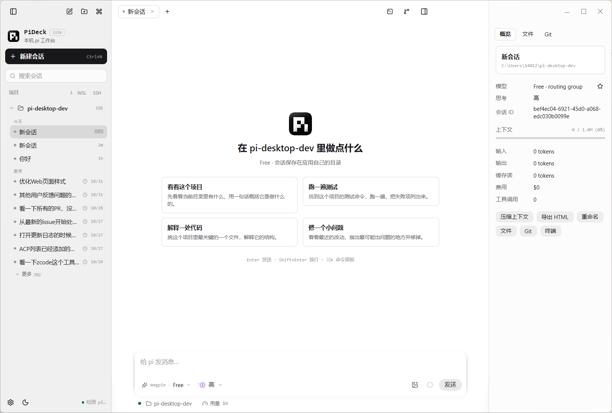

<p align="center">
  
</p>

<h1 align="center">PiDeck</h1>

<p align="center"><strong>为 pi 与 ACP 智能体打造的原生工作台</strong></p>

<p align="center">
  项目、对话、代码与工具过程，在一个工作空间里保持连贯。
</p>

<p align="center">
  <a href="https://github.com/ayuayue/PiDeck/actions/workflows/ci.yml?query=branch%3Ansgo"></a>
  <a href="https://nsgo.dev/"></a>
  <a href="go.mod"></a>
</p>

<p align="center">
  <a href="#下载">下载</a> ·
  <a href="#快速上手">快速上手</a> ·
  <a href="#手机与-web">手机与 Web</a> ·
  <a href="#文档">文档</a> ·
  <a href="docs/ROADMAP.md">路线图</a> ·
  <a href="https://github.com/ayuayue/PiDeck/issues">反馈</a>
</p>



PiDeck 将 [pi](https://pi.dev/) 与支持 [ACP](https://agentclientprotocol.com/) 的命令行智能体带到同一个图形工作台：并行处理多个项目，查看实时工具过程，编辑文件、检查差异，再从手机或浏览器接着处理。

主界面由 [NSGo](https://nsgo.dev/) 原生渲染，桌面程序以一个 Go 二进制运行；内置浏览器按需使用系统 WebView。智能体进程、项目文件和 Git 操作由桌面宿主管理，Android、iOS 与 Web 共用远程客户端。

> **分支说明**：原生版在 [`nsgo`](https://github.com/ayuayue/PiDeck/tree/nsgo) 分支开发，与 Electron 版共用仓库、Star 和 Issues。旧版位于 `main` / `dev`；原生版的应用标识、数据目录与插件格式独立。提交原生版的 PR 时，请选择 `nsgo` 为目标分支。

产品名称统一为 **PiDeck**，版本号单独显示（当前为 `2.0.0`）。既有安装 ID、环境变量、数据路径和插件运行时标识保留兼容，避免配置、会话和已安装插件失效；外部仓库地址及第三方协议的版本标记不随产品名称替换。

## 核心能力

| 场景 | 你可以做什么 |
| --- | --- |
| **管理多个项目** | 接入本机、WSL 与 SSH 工作区；用标签、分组、置顶和归档整理会话，追踪分叉与父子会话 |
| **与智能体协作** | 使用 pi 或 ACP 预设，查看流式回答、思考与工具调用，处理提问和权限请求，切换模型与思考等级 |
| **推进复杂任务** | 使用计划、目标与定时任务，查看待办、子代理和工作流历史，从任务结果跳回对应轮次 |
| **完成代码工作** | 在对话旁编辑与预览文件，检查 diff、暂存和提交，使用原生终端，评审 GitHub 拉取请求与议题 |
| **跨设备继续** | 在手机或 Web 查看会话、发消息、审批、编辑文本文件和操作 Git；可选局域网、虚拟网络或 App 中继 |
| **接入自己的工具** | 管理 MCP、技能、提示词、智能体与声明式插件，使用自定义主题和快捷键 |
| **处理更多内容** | 生成或描述图片、翻译文字、导入语音转写，预览 Markdown、HTML、PDF、图片、音视频及 Office 文件 |
| **了解运行情况** | 查看上下文与用量、通知历史、进程和分类日志，导出诊断与设置备份，使用加密设置同步 |

支持从 Claude Code、Qoder、Codex CLI、Cursor、Kimi Code / Kimi Work、MiniMax、ZCode、OpenCode、WorkBuddy 与 CodeBuddy 导入历史会话。导入会创建应用自己的副本，保留来源文件。

界面提供 **简体中文、English、繁體中文、日本語、한국어、Русский、Français** 七种语言，支持浅色、深色、自定义配色、字体和阅读布局。

完整操作见[使用指南](docs/USER-GUIDE.md)；当前边界与待验收项见[已知限制](docs/USER-GUIDE.md#已知限制)和[路线图](docs/ROADMAP.md)。

## 下载

从 [原生版稳定通道](https://github.com/ayuayue/PiDeck/releases/tag/nsgo-stable)或 [原生版开发通道](https://github.com/ayuayue/PiDeck/releases/tag/nsgo-dev)查看发布记录并选择对应平台的附件。以通道实际提供的构建为准；仓库的全局「Latest」可能指向 Electron 版。

| 平台 | 架构 | 分发形式 |
| --- | --- | --- |
| Windows | x64 / arm64 | 安装程序；可从源码打包便携版 |
| macOS | Intel / Apple Silicon | DMG |
| Linux | x64 / arm64 | DEB、Arch 包、AppImage |
| Android | arm64 | APK，作为桌面端的远程客户端 |
| iOS | arm64 | IPA；未签名产物需要自行签名 |
| Web | WebAssembly | 由带 Web 资源的桌面构建提供，或自行托管 |

发布包附带 `SHA256SUMS`。自动更新、签名条件和本地打包方式见[开发与发布](docs/DEVELOPMENT.md#打包与发布)。

## 快速上手

### 1. 准备智能体后端

- **使用 pi**：先安装 [pi](https://pi.dev/)，确认终端能运行 `pi --version`。PiDeck 使用 `pi --mode rpc` 启动它。
- **使用 ACP**：在「设置 → 集成 → 管理预设…」选择并检测对应 CLI。使用 `npx` 的预设需要 Node.js，首次启动会下载依赖；模型登录与权限能力由对应 CLI 提供。

「设置 → 运行环境」集中管理 pi、外部编辑器、网络代理、远程运行和数据目录。pi 显示检测状态、版本、完整路径与失败原因，可重新检测、选择自定义程序或恢复自动检测；切换只影响之后启动的本机会话。检查到新版后可直接更新当前选中的 pi，页面保留查询结果、更新状态与失败详情，成功后重新读取版本。外部编辑器列表紧凑地单行显示图标、名称、路径和操作；路径过长时省略中段，悬停可查看完整路径。支持检测、添加、设为默认和删除；删除只移除记录。程序路径不包含启动参数。原有默认编辑器配置会保留，清空列表后不会在重启时自动加回。

### 2. 添加项目并开始对话

打开 PiDeck，在欢迎页选择项目文件夹，或使用「直接对话」。项目在第一次发送前需要确认信任。

在输入区选择后端、模型与思考等级，写下第一条消息。pi 的供应商可在「设置 → 模型与供应商」管理，登录凭据在「设置 → 登录与密钥」管理；ACP 按所选 CLI 的配置使用。后端在首条消息发出前可切换。本机 pi 的模型与思考档位在后台预取，可在会话启动前直接选择；修改模型或认证后自动更新，外部修改在再次打开模型菜单时检查。刷新期间保留上次成功的列表，首次加载失败自动重试，也可点击菜单中的「刷新模型」。预选结果在发送前应用，无需重启现有进程。

### 3. 在工作台里完成后续操作

用 `Ctrl+P` 打开命令面板查找操作；右侧文件、Git 与概览面板用于检查产物和任务状态。运行过程会实时显示，等待你的决定时会出现提问或权限卡片。

「设置 → 通用 → 标签打开方式」默认使用预览：打开历史会话时只保留一个可替换的临时标签，斜体标题表示尚未固定，重启后不恢复该预览。双击标签、在标签右键菜单选择「固定标签页」可保留；新建会话与发送消息也会自动固定。选择「固定」后，当前预览和之后打开的会话都会保留；切回预览不改变已有固定标签。左侧会话的置顶独立控制列表顺序。

已有其他工具的历史记录，可从欢迎页或命令面板选择「导入会话…」。更多操作与键位见[使用指南](docs/USER-GUIDE.md)及[自定义与扩展](docs/CUSTOMIZATION.md)。

<details>
<summary>从源码运行</summary>

需要 [go.mod](go.mod) 声明的 Go 工具链，NSGo 版本由模块固定。克隆时选择原生版分支：

```sh
git clone --branch nsgo https://github.com/ayuayue/PiDeck.git
cd PiDeck
go run ./scripts
```

交互脚本提供开发、单目标构建、设备与诊断入口。环境准备、热重载、Web 构建及测试方法见[开发指南](docs/DEVELOPMENT.md)。

</details>

## 手机与 Web

1. 在电脑上打开「设置 → 远程」，开启「允许手机连接」。
2. 手机 App 扫描二维码或粘贴连接链接；浏览器打开桌面提供的 Web 链接。
3. 选择项目与会话，继续发消息、查看工具过程、处理审批或检查文件和 Git。

电脑需要保持运行并能被客户端访问。局域网和 Tailscale / EasyTier 可用于 App 与 Web；中继仅支持 Android / iOS App。Web 页面需要使用带 Web 资源的桌面构建或自行托管。

连接方式、令牌管理、排障及 HTTP 接口见[手机与 Web 指南](docs/REMOTE.md)；公网接入见[自托管说明](docs/remote-self-host.md)。

## 数据与隐私

- **本地数据**：会话、配置与日志由各自宿主管理。原生版首次使用时可在后台迁移旧 Electron 版的本机 pi 会话、项目及聊天文件，展示进度和结果，成功后不再自动迁移；原文件保留。设置 → 数据管理 →「从目录导入会话」可递归导入其他目录中的 pi 会话。原生版数据目录独立，可用 `PIDECK_V2_HOME` 指定位置。模型请求仍会发送到你选择的服务商。
- **分享与备份**：分享副本默认隐藏工具过程等内容，并遮盖常见路径和凭据，发送前仍需检查。设置包可能包含凭据，请妥善保管。
- **远程访问**：连接链接包含访问令牌。局域网直连使用 HTTP；虚拟网络提供链路加密，App 中继使用隧道内 TLS 与证书指纹校验。
- **使用统计**：匿名 PostHog 统计默认开启，每天最多一次，包含版本、平台与功能数量，不含会话内容、项目路径、文件名或凭据；可在「设置 → 通用 → 安全与隐私」关闭。
- **工具执行**：项目信任、权限请求与工具安全门共同约束操作；工具安全门只对本机 pi 生效，ACP 的权限由对应 CLI 管理。

数据位置、备份范围与恢复边界见[整理数据](docs/USER-GUIDE.md#整理数据)。

## 文档

| 想了解什么 | 从这里开始 |
| --- | --- |
| 工作台、会话、编辑器、Git、设置与数据 | [使用指南](docs/USER-GUIDE.md) |
| 手机连接、Web、网络方式与远程 API | [手机与 Web](docs/REMOTE.md) · [自托管](docs/remote-self-host.md) |
| 主题、提示词、快捷键、语言与插件 | [自定义与扩展](docs/CUSTOMIZATION.md) · [插件契约](docs/PLUGINS.md) |
| 本地开发、设备、构建、更新与发布 | [开发与发布](docs/DEVELOPMENT.md) |
| 包边界、状态所有权与工程规范 | [架构](ARCHITECTURE.md) · [贡献指南](CONTRIBUTING.md) · [代理规范](AGENTS.md) |
| 功能进度、限制与验收记录 | [路线图](docs/ROADMAP.md) · [验收记录](docs/VALIDATION-2026-11-20.md) |

## 参与贡献

欢迎提交问题、改进文档、翻译与代码。反馈问题时请说明版本、系统、所用后端和复现步骤；可从「设置 → 诊断」导出诊断包，分享前检查其中内容。

原生版的改动请提交到 **`nsgo` 分支**。开发前阅读[贡献指南](CONTRIBUTING.md)；涉及包边界或状态所有权时同时参考[架构说明](ARCHITECTURE.md)。七种语言的译文与新增用户可见文案需同步维护。

感谢 [pi](https://pi.dev/)、[NSGo](https://nsgo.dev/) 与 [ACP](https://agentclientprotocol.com/) 生态的工作，以及每一位贡献代码、反馈和翻译的参与者。
