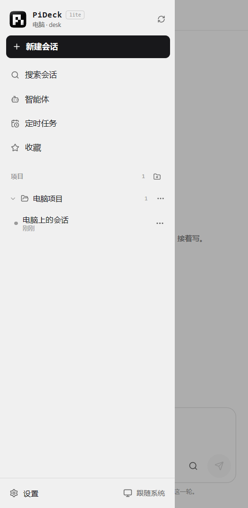

# 手机与 Web

[返回首页](../README.md) · [使用指南](USER-GUIDE.md) · [公网与自托管](remote-self-host.md)

Android、iOS 与 Web 是桌面端的远程客户端：智能体、项目文件、Git 和会话都由电脑提供，电脑需要保持运行。

## 建立连接

1. 在电脑上打开「设置 → 远程」，开启「允许手机连接」。端口通常为 8787，以设置页显示为准；防火墙需允许客户端访问该端口。
2. 选择客户端能访问的地址，复制连接链接或显示二维码。
3. 在手机 App 的连接页扫码或粘贴链接，或在浏览器打开 Web 链接。

完整链接带有地址和令牌，例如 `http://<电脑地址>:<端口>/?token=<访问令牌>`。连接页支持只填地址再单独填写令牌；手动输入的新令牌优先。链接包含访问凭据，请只交给可信设备。

App 扫码优先使用系统相机实时识别；不支持时可拍照或从相册选二维码（图片上限 6 MB、2000 万像素）。取消扫码保留表单，最近 5 个连接可一键重连。

## 选择网络方式

| 方式 | 适用端 | 使用条件 |
| --- | --- | --- |
| 局域网 | App / Web | 电脑与客户端网络互通，直接访问远程端口；HTTP + 令牌 |
| Tailscale / EasyTier | App / Web | 双方已加入虚拟网络；使用设置页检测或手动填写的虚拟 IP |
| 中继 | Android / iOS App | 电脑主动连接中继，手机扫描配对链接；无需额外虚拟网卡 |
| 自定义公网地址 | App / Web | 已通过 Tunnel、frp 或反向代理暴露桌面服务；建议使用 HTTPS |

中继只转发字节，桌面与手机在隧道里再建立 TLS，手机按配对链接的指纹固定证书。Web 浏览器不能使用这一原始套接字中继；跨网访问需采用虚拟网络或可访问的 HTTPS 地址。

设置中的「中继地址」可测试连接和恢复默认；Worker 的 HTTPS 地址会转换为 WSS 并补齐隧道路径。自建步骤见[Cloudflare Worker](../infra/relay-worker/README.md)或[公网接入指南](remote-self-host.md)。自定义公网地址只使用域名和端口，反向代理应转发到服务根路径。

### 令牌与断开

- 令牌过期默认关闭。开启后电脑每 24 小时轮换令牌；保持连接的客户端通过 `X-PiDeck-Token` 响应头接续，断开超过一天的设备需重新扫码。
- 手动断开会清除旧错误；鉴权失败等被动断开保留原因。旧连接迟到的响应不会恢复已断开的连接或覆盖新连接。
- Web 连接成功后移除地址栏中的令牌参数。复制原始配对链接、截图或日志前仍需检查敏感内容。

## 在客户端工作

连接后先进入新建会话页，可选择电脑上的项目并写第一句话。窄屏使用侧边抽屉，宽屏（至少 820 pt）将抽屉固定为左栏。支持与桌面相同的七种界面语言，可单独记住客户端语言与主题。

  
  

| 区域 | 操作 |
| --- | --- |
| 项目与会话 | 添加电脑上的项目路径、创建会话、重命名、置顶、归档与删除；删除需要确认，受保护的 pi 原始会话不能删除 |
| 搜索 | 按标题和正文搜索电脑上的会话；点击匹配片段进入对应会话并定位，另有会话内搜索 |
| 对话输入 | 文本、图片（单张最多 6 MB）、文件引用、计划 / 目标 / 生图、增强与续写；失败时恢复待发文字 |
| 过程与审批 | 查看思考和工具结果，处理 pi 提问、批量问题与 ACP 权限卡；运行中可停止 |
| 会话设置 | 调整后端支持的模型与思考等级，查看用量；后端只能在首条消息前切换 |
| 文件 | 浏览电脑项目、预览与编辑文本；保存携带版本校验，冲突保留编辑内容，不覆盖新文件 |
| Git | 查看分支与改动、检查补丁、暂存或取消暂存、提交、切分支、获取 / 拉取 / 推送 |
| 评审 | 浏览拉取请求与议题，评论、评审、合并、关闭 / 重开，交给电脑会话进行 AI 评估 |

会话列表默认显示最近 3 天，置顶、运行中和待确认的更早会话仍会保留；其余历史可展开。一般列表每 2.5 秒刷新，运行中的会话每 1.2 秒更新。手机输入框以发送按钮提交，回车换行。

切换电脑、项目或会话时，迟到的读取结果不会进入新页面。断开后保留未保存文本供复制；重新连接后需重新读取文件版本再保存。会话操作与父子会话导航的完整清单见[移动端命令](MOBILE-COMMANDS.md)，评审前提见[评审面板](REVIEW.md)。

## Web 页面与常见问题

**打开地址却没有页面？** 桌面构建需要嵌入 Web 资源，也可单独托管发布的 Web 包。从源码运行时先按[开发指南](DEVELOPMENT.md#web-构建与嵌入)生成站点。

**手机连不上？** 先确认桌面服务开启、地址和端口正确、防火墙放行、两端网络互通。局域网地址不能直接用于移动网络；跨网络请选择虚拟网络、中继或公网地址。模拟器使用 `10.0.2.2` 访问宿主机，详见[模拟器说明](DEVELOPMENT.md#windows-android-模拟器)。

**能离线继续运行任务或接收推送吗？** 任务在电脑运行；手机端通知依赖持续连接与轮询。系统挂起或离线后的远程推送仍需要 APNs / FCM 及后台服务。

**页面提示版本过期？** 当 `/api/ping` 返回的桌面版本与页面不一致时会提示刷新。Web 本身不安装更新，刷新以获取桌面提供的新页面。会话路由使用 `#/session/<ID>`，可直接定位会话。

## 远程 HTTP 接口

| 方法 | 路径 | 作用 |
| --- | --- | --- |
| GET | `/api/ping` | 主机名与版本，连接时探活 |
| GET | `/api/state` | 项目、会话、置顶、运行状态与等待回答的问题 |
| GET | `/api/session/{id}` | 一个会话的消息；运行中带 live 文本，等待回答时带 `ask` |
| GET | `/api/session/{id}/options` | 模型列表、当前模型、思考等级、后端与可用草稿工具；pi 没起会顺手拉起 |
| GET | `/api/search?q=&project=` | 跨会话搜消息正文，返回会话、标题与片段（按文件缓存） |
| GET | `/api/git?project=` | 项目的分支、上游、领先/落后与改动文件（只读） |
| GET | `/api/git/diff?project=&path=` | 一个改动文件的补丁；只接受仓库已报告的路径 |
| POST | `/api/git/stage` | `{project,path,stage}` 暂存或取消暂存一个文件 |
| POST | `/api/git/commit` | `{project,message}` 提交已暂存的内容 |
| POST | `/api/git/checkout` | `{project,branch}` 切换本地分支 |
| POST | `/api/git/sync` | `{project,action}` 获取 / 拉取 / 推送 |
| GET | `/api/review?project=&kind=&state=&q=&limit=` | 项目的拉取请求（`kind=pr`）或议题（`kind=issue`）；`missing` 表示这台机器没有 gh |
| GET | `/api/review/detail?project=&kind=&number=` | 一条的描述、讨论、检查与改动文件 |
| POST | `/api/review/action` | `{project,kind,number,action,body,method}` 评论 / 合并 / 关闭 / 重开 |
| GET | `/api/review/diff?project=&number=` | 拉取请求的整份补丁（统一 diff） |
| POST | `/api/review/evaluate` | `{project,kind,number}` 让电脑开一个会话评估它，返回 `{session}` |
| POST | `/api/projects` | `{path,remove}` 在电脑上添加/移除项目文件夹 |
| POST | `/api/sessions` | `{project}` 新建会话，返回 `{id,title}` |
| POST | `/api/sessions/{id}/prompt` | `{text,images:[{mime,data}]}` 发一条消息；运行中自动改成 steer |
| POST | `/api/sessions/{id}/stop` | 停止当前一轮 |
| POST | `/api/sessions/{id}/rename` | `{title}` 改名 |
| POST | `/api/sessions/{id}/pin` | `{pinned}` 置顶或取消 |
| POST | `/api/sessions/{id}/model` | `{provider,id}` 切模型 |
| POST | `/api/sessions/{id}/thinking` | `{level}` 切思考等级 |
| POST | `/api/sessions/{id}/mode` | `{mode}` 下一轮要什么：`plan` / `goal` / `imagegen`，`normal` 回到普通提问 |
| POST | `/api/sessions/{id}/backend` | `{backend,preset}` 换 pi / ACP 后端；第一条消息之后拒绝 |
| POST | `/api/sessions/{id}/tools` | `{tool,text}` 用电脑的工具模型改写（`prompt`）或续写（`predict`）草稿，返回 `{text}` |
| POST | `/api/sessions/{id}/image` | `{prompt}` 用电脑的生图供应商画一张，返回 `{images:[{mime,data}]}` |
| POST | `/api/sessions/{id}/answer` | `{confirmed}` / `{value}` / `{cancelled}` 回答电脑上等待的确认、选项或输入 |
| POST | `/api/sessions/{id}/delete` | 删除会话（pi 自己的会话会拒绝） |
| POST | `/api/voice` | `{format:"wav",data}`（base64 的 16 kHz 单声道 WAV）转写成 `{text}`；识别在电脑上调用火山引擎，未配置凭据返回 503 |

本表列出主要客户端接口，字段契约以 [remotewire](../internal/remotewire) 与桌面路由实现为准。调用需有效访问令牌；涉及文件、Git 和共享平台的写操作有各自校验。飞书入站另走 `/api/feishu` 并校验 Verification Token。

运行中发送消息按后端能力投递：pi 可加入当前回合或排队，ACP 仅排队到下一轮。语音接口保留给自定义客户端，当前手机 App 不提供录音入口。
