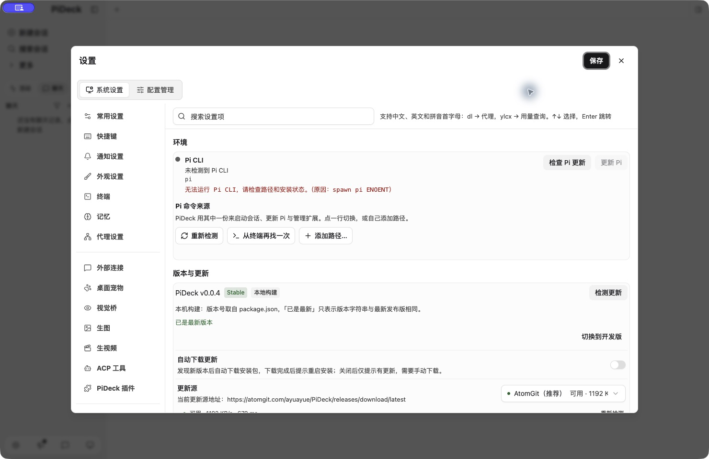

# macOS 签名、公证与自动升级隔离演练

状态：2026-11-09 已在本机 x64 跑通 A（0.0.1）→ B（0.0.2），及修复后的 B → D（0.0.4）真实自动升级。各包及安装后的 D 均通过签名、公证、stapler 与 Gatekeeper；D 正常打开主窗口和版本设置，数据存活标记 SHA256 不变。实际记录见 `.tmp-mac-upgrade-lab/evidence/verification.json`，截图见 `evidence/upgrade-repaired.png`。

本工具可直接在 fork 的本地检出目录运行。不要求先提交 PR，不创建任何 GitHub Release，也不修改源仓库正式版。安装、构建、应用数据和 Node 更新缓存归属 `.tmp-mac-upgrade-lab/`。macOS 原生安装辅助进程可使用系统临时/缓存目录，其身份与正式包分离。

## 隔离边界

- 测试包叫 `PiDeck Upgrade Lab.app`，Bundle ID 为 `cc.debugtools.pideck.upgrade-lab`，与正式版及 PiDeck Dev 分开。
- 测试专用 bootstrap 是该包的入口，正式包不会加载它。加载 PiDeck 主进程之前，固定 Electron 的 home、appData、userData、sessionData、temp，以及 pi/DSH 配置目录。
- bootstrap 仅在测试进程覆盖 Node `os.homedir()`，不修改 `HOME`。因此模型配置、技能安装和 electron-updater 缓存也落到测试目录。
- 重启时重新执行 bootstrap，隔离不依赖启动命令继承环境变量。缺少测试根目录标记时拒绝启动。
- bootstrap 禁止注册正式 deep link 或登录项。测试过程中使用空白配置和临时数据，不导入真实项目或会话。
- 更新源烘焙为 `http://127.0.0.1:18766`，覆盖设置项。更新服务仅提供所选测试版本的真实清单、ZIP 和 blockmap，支持 HTTP Range；不提供目录浏览或任意文件读取。
- 构建显式 `--publish never`，移除子进程中的 GitHub/AtomGit 发布 token。两个版本使用同一代码和签名身份，版本为 A=`0.0.1`、B=`0.0.2`。

## 首次配置

Mac 登录钥匙串中需有带私钥的 Developer ID Application 证书。若存在多个身份，用 `CSC_NAME` 显式选择；仅一个时自动识别。

在终端执行以下命令，按提示输入 Apple App 专用密码（不要把密码写入脚本、命令参数或 Git）：

```bash
xcrun notarytool store-credentials PiDeck-Isolated-Notary --apple-id <Apple邮箱> --team-id <TeamID>
```

可用 `APPLE_KEYCHAIN_PROFILE` 指定另一份已有 profile。该命令只保存本机公证凭据，不会读取 GitHub Secrets。

## 构建与运行

```bash
node scripts/mac-upgrade-lab.mjs build
node scripts/mac-upgrade-lab.mjs serve
```

保留更新服务，在另一个终端运行：

```bash
node scripts/mac-upgrade-lab.mjs install-a
node scripts/mac-upgrade-lab.mjs launch
```

`install-a` 拒绝覆盖已存在的测试安装。它不会查找或覆盖 `/Applications/PiDeck.app`。编译在工作区快照中完成；`--skip-compile` 只适用于快照已成功编译、代码无变更的情况。

在测试应用中打开设置，检查更新，下载 B，点击重启安装。随后检查版本是否变为 `0.0.2`，并运行：

```bash
node scripts/mac-upgrade-lab.mjs status
```

验收必须同时满足：

1. A、B 均通过 Developer ID、hardened runtime、`codesign --verify --deep --strict`、`stapler validate`、`spctl --assess` 验证。
2. 本机 feed 日志显示清单与真实 ZIP 请求；runtime 日志出现 A 的 `update-downloaded`。
3. 真正执行重启安装后，原测试安装目录内版本变为 B，B 的 `ready` 记录仍指向相同的测试 home/userData/feed。
4. `user-data/upgrade-survival.txt` 内容和 SHA256 保持不变。
5. 正式应用、现有配置和源仓库 Release 均不参与本次演练。

此测试覆盖真实 MacUpdater/Squirrel.Mac 安装替换；它不是假安装器下载测试，也不代替正常功能的人工回归。

本机验收覆盖 Intel x64。ARM64 发布 job 已配置为独立 Apple Silicon runner，尚未在真实 ARM 机器验证。

## 验证后续修复版本

保留同一安装与测试数据，构建下一个版本并将本机 feed 切到它，可以重复验证升级：

```bash
node scripts/mac-upgrade-lab.mjs build --version 0.0.5 --label E
# 先停止自己启动的旧 feed，再运行：
node scripts/mac-upgrade-lab.mjs serve --label E
```

不要重新执行 install-a 覆盖现有测试包。正式发布 workflow 的草稿公开与 AtomGit 同步仍需在代码审核合入后验证，本机演练不会执行这些远端写入。

## 本次修复的启动错误

演练 C（0.0.3）虽通过签名、公证，也成功被 B 下载并替换，但启动时报 `__PIDECK_RELEASE_BUILD__ is not defined`。原因是快速构建配置 `electron.vite.main.mjs` 少了完整配置已有的 define；已补齐，并用两套实际构建配置执行构建来源判定的回归测试。失败 C 保留在隔离目录 `install/Failed-C.app`，测试数据不删除；恢复 B 后用 D（0.0.4）继续验证。

D 已通过上述完整升级验证，截图与正常版本界面均为 0.0.4。当前测试安装是 D，不需要重新执行 `install-a`。验证结束停止本任务 feed 并退出测试应用；用户可运行 `serve --label D` 与 `launch` 自行打开体验。

这也说明仅有 Electron `ready` 日志不足以判定启动成功，验收需同时观察主窗口和版本界面。

## 本机验证截图


